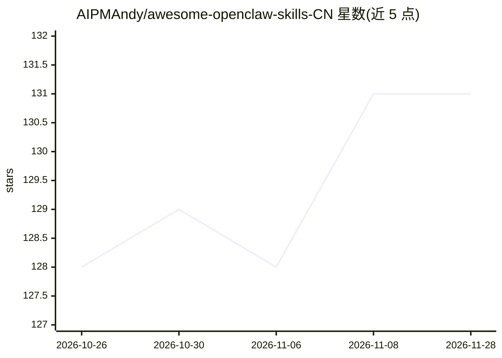

# AIPMAndy/awesome-openclaw-skills-CN

⭐ 131 · Apache-2.0 · 推送 2026-11-27 · [GitHub](https://github.com/AIPMAndy/awesome-openclaw-skills-CN) · [官网](https://github.com/AIPMAndy/awesome-openclaw-skills-CN/blob/main/CHINESE-MODELS.md) · 个人维护 · 中文 README

**面向中文开发者的 OpenClaw Skills 中文分类目录与接入指南**

基于 VoltAgent/awesome-openclaw-skills 翻译制作的技能精选目录，从 ClawHub 注册表的 5,705 个社区技能中过滤垃圾、加密货币、重复与恶意条目后收录 2,868 个，按分类整理并保留原文条目。面向想快速上手 OpenClaw 的中文开发者，附 DeepSeek、通义千问、GLM、Moonshot、豆包等国产模型接入指南及飞书/企业微信等推荐 Skills。安装支持 ClawHub CLI（npx）、手动复制到 skills 目录及国内 npm 镜像加速。MIT 许可，声明为人工整理而非安全审计。

## 筛选速览

| 维度 | 判定 | 备注 |
|---|---|---|
| AI 角色 | `ai-knowledge` | 知识聚合/清单类 |
| 许可风险 | `permissive` | Apache-2.0 |
| 部署形态 | `library` | 以包/库形式分发 |
| 模型依赖 | — | README 未给出锁定关系 |
| 硬件要求 | — | 无带数字的原话,不猜 |
| 安装摩擦 | `low` | 无编译、无系统依赖或容器化 |
| 成熟度 | — | 结构信号不足 |

## 能力要点

- 收录 ClawHub 2,868 个社区 Skills，含过滤明细（剔除 2,748 条）
- 国产大模型接入指南：DeepSeek/通义千问/GLM/Moonshot/豆包
- 三种安装路径：ClawHub CLI、手动复制、对话式安装
- 国内 npm 镜像（npmmirror）加速与本地化阅读

## 适用场景

- 中文开发者快速查找并安装 OpenClaw Skills
- 为 OpenClaw 接入国产大模型寻找配置指南
- 按分类浏览社区技能生态，了解哪些条目被过滤及原因

## 场景标签

`精选清单` · 领域:学习与行业

## 证据(README 行号)

> L7: > **TL;DR｜一句话**：awesome-openclaw-skills-CN 是 AI 酋长 Andy 整理的 OpenClaw Skills 中文精选目录。适合想快速找到并安装 OpenClaw Skills 的中文开发者
> L13: **想找 OpenClaw Skills 中文资料？** 这里把 ClawHub 上 2,868 个社区 Skills 按分类整理好，还附了国产大模型（DeepSeek、通义千问、GLM、Moonshot、豆包）接入指南和中文开发
> L56: OpenClaw（曾用名 Moltbot / Clawdbot）是一个运行在本地机器上的 AI 助手。Skill 可以扩展它的能力，让它连接外部服务、自动化工作流并执行专用任务。

## 星数曲线

2026-10-26 128 → 2026-11-28 131（+3）

---
*卡片 v1 · prompt 1.4 · 生成 2026-11-28 · 置信度 high · 依据 README sha `9395f4ff5113` · [字段定义](../../DATASET.md)*
