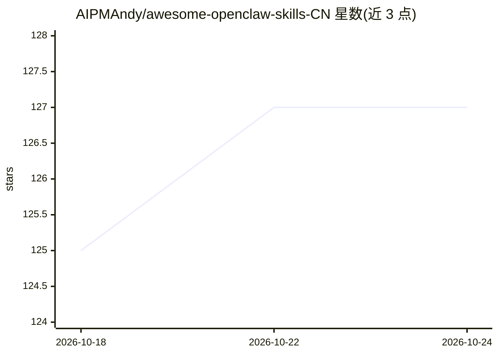

# AIPMAndy/awesome-openclaw-skills-CN

⭐ 128 · Apache-2.0 · 推送 2026-10-22 · [GitHub](https://github.com/AIPMAndy/awesome-openclaw-skills-CN) · [官网](https://github.com/AIPMAndy/awesome-openclaw-skills-CN/blob/main/CHINESE-MODELS.md) · 个人维护 · 中文 README

**面向中文开发者的 OpenClaw Skills 精选清单（2,868 个）**

基于 VoltAgent/awesome-openclaw-skills 翻译制作的中文策展清单：从 ClawHub 官方注册表 5,705 个社区技能中过滤垃圾、加密货币、重复及恶意条目后收录 2,868 个，按分类组织。特色内容为国产大模型（DeepSeek/通义千问/GLM/Moonshot/豆包）接入指南与中文开发者推荐 Skills（飞书/企业微信/小红书等）。提供 ClawHub CLI 与手动复制两种安装方式，并附国内 npm 镜像配置。声明为人工整理而非安全审计。

## 筛选速览

| 维度 | 判定 | 备注 |
|---|---|---|
| AI 角色 | `ai-knowledge` | 知识聚合/清单类 |
| 许可风险 | `permissive` | Apache-2.0 |
| 部署形态 | `library` | 以包/库形式分发 |
| 模型依赖 | — | README 未给出锁定关系 |
| 硬件要求 | — | 无带数字的原话,不猜 |
| 安装摩擦 | `low` | 无编译、无系统依赖或容器化 |
| 成熟度 | — | 结构信号不足 |

## 能力要点

- 从 ClawHub 5,705 个技能中过滤后收录 2,868 个，附过滤明细
- 国产大模型（DeepSeek/通义千问/GLM/Moonshot/豆包）接入指南
- 中文开发者推荐 Skills（飞书/企业微信/小红书/知乎/B站）
- 国内 npm 镜像加速配置说明

## 适用场景

- 中文开发者查找 OpenClaw 技能并了解安装方式
- 为 OpenClaw 接入 DeepSeek/通义千问等国产模型
- 了解 ClawHub 技能的过滤标准与安全注意事项

## 场景标签

`精选清单` · 领域:学习与行业

## 证据(README 行号)

> L1: 🇨🇳 发现 2868 个社区构建的 OpenClaw Skills，按分类整理，面向中文开发者友好阅读。
> L9: **想找 OpenClaw Skills 中文资料？** 这里把 ClawHub 上 2,868 个社区 Skills 按分类整理好，还附了国产大模型（DeepSeek、通义千问、GLM、Moonshot、豆包）接入指南和中文开发者
> L79: 截至 **2026 年 2 月 7 日**，OpenClaw 官方公开注册表（ClawHub）包含 **5,705** 个社区技能；本列表收录 **2,868** 个。以下是过滤掉的部分：

## 星数曲线

2026-10-18 125 → 2026-10-24 127（+2）

---
*卡片 v1 · prompt 1.4 · 生成 2026-10-23 · 置信度 mid · 依据 README sha `f1ced9b6ce4b` · [字段定义](../../DATASET.md)*
