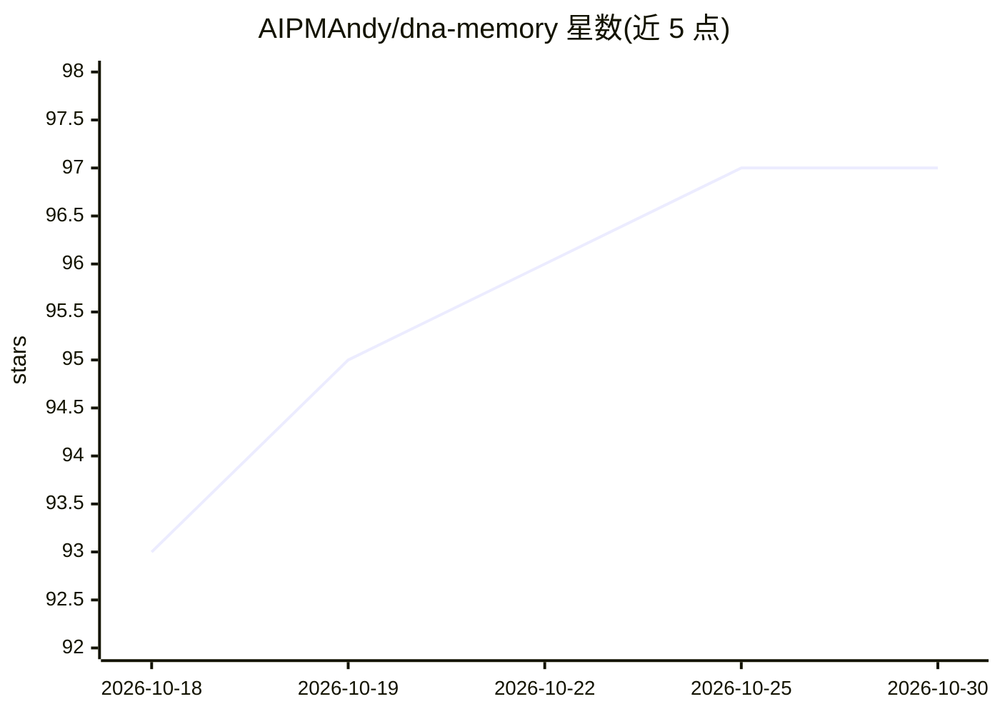

# AIPMAndy/dna-memory

⭐ 97 · Python · Apache-2.0 · 推送 2026-10-29 · [GitHub](https://github.com/AIPMAndy/dna-memory) · [官网](https://github.com/AIPMAndy/dna-memory/blob/main/QUICKSTART.md) · 个人维护 · 中文 README

**给多 AI 客户端共用的本地优先长期记忆 MCP 服务**

面向 Codex、Claude Code、Claude Desktop 与 Hermes 用户的记忆 MCP 服务：以一个 Markdown/Obsidian 目录作为长期记忆真源，SQLite 仅作可重建索引，多个 AI 客户端通过同一 MCP 服务（stdio）读写。机制上不保存完整会话，只经信号提取、加权判断、认知分型（8 种类型）、验证结晶后写入短小结论，提供 7 个 MCP 工具（recall/get/remember/feedback 等），支持去重、supersedes 替代与凭证敏感内容拒绝。通过 git clone 源码安装，配置 profile 后运行。限制：系统只做精确文本去重，不用模糊合并；Claude Desktop 云端会话无本地正文时只能显式写回。

## 筛选速览

| 维度 | 判定 | 备注 |
|---|---|---|
| AI 角色 | `ai-ecosystem` | LLM/agent 周边工具 |
| 许可风险 | `permissive` | Apache-2.0 |
| 部署形态 | `None` |  |
| 模型依赖 | — | README 未给出锁定关系 |
| 硬件要求 | — | 无带数字的原话,不猜 |
| 安装摩擦 | `low` | 无编译、无系统依赖或容器化 |
| 成熟度 | — | 结构信号不足 |

## 能力要点

- 多个 AI 客户端共用一个 Markdown 真源与同一 MCP 服务
- 先处理再存储：信号筛选、加权、8 类认知分型、验证结晶
- 7 个 MCP 工具覆盖召回、写入、反馈、重建索引
- 凭证与疑似敏感内容拒绝写入，SQLite 索引可删除重建

## 适用场景

- 同时使用 Codex 与 Claude Code 时让两边共享一份长期记忆
- 让 AI Agent 在新任务前召回已验证的偏好、决策与教训
- 用 Obsidian 直接打开和查看 Agent 的记忆目录

## 场景标签

`Agent 记忆` · 领域:Agent 开发

## 证据(README 行号)

> L11: **想给 Claude Code、Codex 加长期记忆？** DNA Memory 是一个本地优先的 AI Agent 记忆 MCP。一个 Markdown / Obsidian 目录当长期记忆，Codex、Claude Cod
> L18: DNA Memory 把一个 Markdown/Obsidian 目录作为长期记忆真源，把 SQLite
> L19: 作为可删除、可重建的索引。多个 AI 客户端通过同一个 MCP 服务召回、写入和反馈，

## 星数曲线

2026-10-18 93 → 2026-10-30 97（+4）

---
*卡片 v1 · prompt 1.4 · 生成 2026-10-23 · 置信度 high · 依据 README sha `ad12ba6f1c7e` · [字段定义](../../DATASET.md)*
