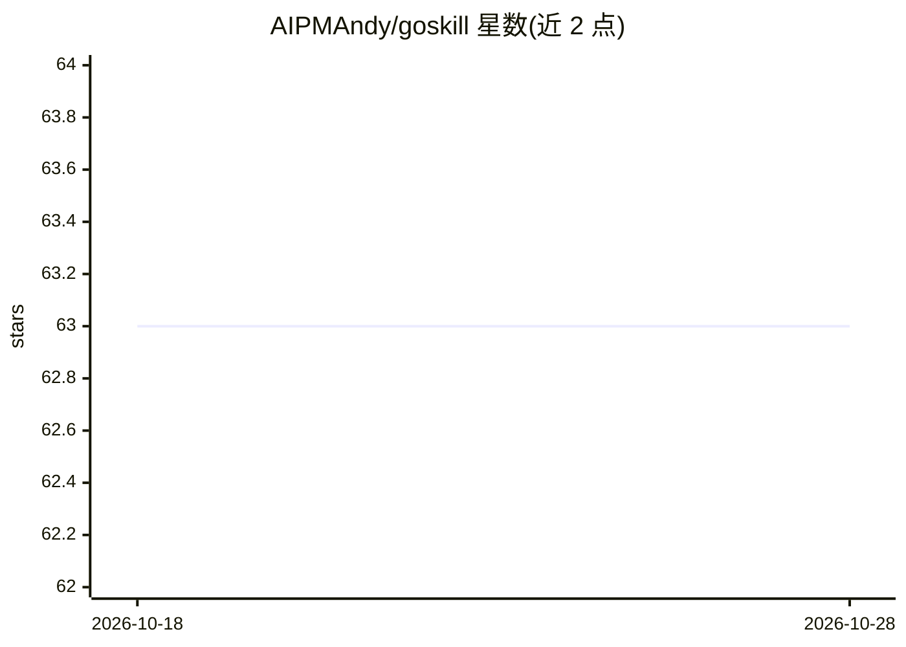

# AIPMAndy/goskill

⭐ 63 · Python · Apache-2.0 · 推送 2026-10-22 · [GitHub](https://github.com/AIPMAndy/goskill) · 个人维护 · 中文 README

**面向 agent 长任务的目标驱动执行封装：达标或超时才停**

Python 轻量库，把一次性 Skill 调用封装为围绕目标持续推进的执行循环：开发者定义 goal、成功 criteria、max_hours/max_attempts，库负责执行-校验-重试，直到达标、超时或主动停止。提供 run() 与 run_with_result() 两种返回方式，内建 status 追踪尝试次数、运行时长、终态原因与 criteria 检查结果。定位为单机单进程的原型，不处理分布式调度、多节点编排与企业级队列。

## 筛选速览

| 维度 | 判定 | 备注 |
|---|---|---|
| AI 角色 | `ai-ecosystem` | LLM/agent 周边工具 |
| 许可风险 | `permissive` | Apache-2.0 |
| 部署形态 | `library` | 以包/库形式分发 |
| 模型依赖 | — | README 未给出锁定关系 |
| 硬件要求 | — | 无带数字的原话,不猜 |
| 安装摩擦 | `medium` | 含编译或系统依赖之一 |
| 成熟度 | `idea` | |

## 能力要点

- goal + criteria + 超时/尝试上限的执行循环
- run_with_result() 返回结构化结果（success/status/attempts/criteria_report）
- 内建 status 状态追踪与终态原因记录
- 提供装饰器与类两种使用方式及最小示例

## 适用场景

- 大规模重构等需要明确验收标准的自动化任务
- 长时间分析或迭代型研究任务的持续推进
- 把执行、校验、重试包装在一起的工作流

## 场景标签

`Agent 框架` · 领域:Agent 开发

## 证据(README 行号)

> L24: > **把任务从“一次性函数调用”变成“围绕目标持续推进，直到满足成功标准”。**
> L159: - **一个面向 OpenClaw / Agent workflow 的实验性封装**

## 星数曲线

2026-10-18 63 → 2026-10-28 63（+0）

---
*卡片 v1 · prompt 1.4 · 生成 2026-10-24 · 置信度 high · 依据 README sha `72940c838073` · [字段定义](../../DATASET.md)*
