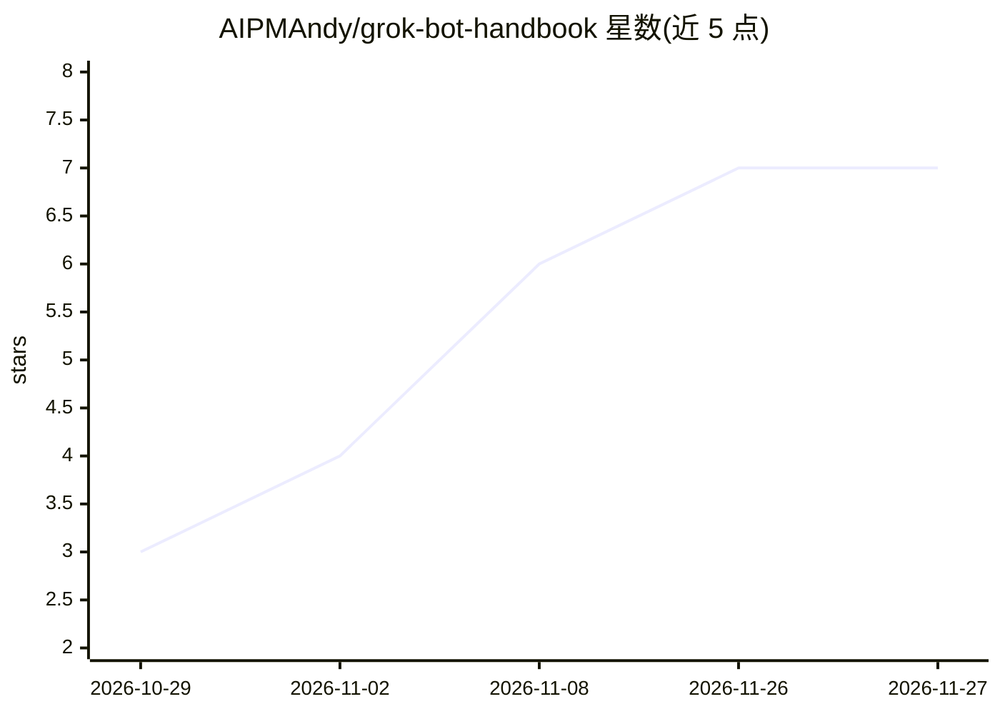

# AIPMAndy/grok-bot-handbook

⭐ 7 · Python · MIT · 推送 2026-11-23 · [GitHub](https://github.com/AIPMAndy/grok-bot-handbook) · [官网](https://aipmandy.github.io/grok-bot-handbook/) · 个人维护 · 中文 README

**中文用户的 Grok Bot 非官方操作教程与任务指令库**

由个人维护的非官方 Grok Bot 中文教程站点仓库：面向想让 AI Agent 替自己执行任务的中文用户，内容覆盖账号开通、订阅套餐辨析、Bot/Skill/Routine 操作、故障诊断与上线安全检查。结构为 26 章教程、40 套可复制任务指令、36 条 FAQ、10 类故障诊断路径与 7 项安全检查清单；关键结论附官方来源并记录核查日期，部署前需通过内容校验脚本。纯静态网站，本地仅需 Python 与 Node.js。

## 筛选速览

| 维度 | 判定 | 备注 |
|---|---|---|
| AI 角色 | `ai-knowledge` | 知识聚合/清单类 |
| 许可风险 | `permissive` | MIT |
| 部署形态 | `None` |  |
| 模型依赖 | — | README 未给出锁定关系 |
| 硬件要求 | — | 无带数字的原话,不猜 |
| 安装摩擦 | `low` | 无编译、无系统依赖或容器化 |
| 成熟度 | — | 结构信号不足 |

## 能力要点

- 26 章教程、40 套任务指令、36 条 FAQ、10 类故障诊断、7 项上线安全检查
- 12 项高风险结论记录来源与核查日期，部署依赖校验脚本（deploy 依赖 verify）
- 纯静态站点，无后端、不用注册、不需要 API Key，进度存于浏览器 localStorage
- 提供 97 页 PDF 电子书下载与全文搜索/筛选/进度标记

## 适用场景

- 想开通并上手 Grok Bot 的中文用户按章节学习操作
- 需要可直接复制的 Agent 任务指令模板（求职、内容生产、运营等）
- 开启长期 Routine 前逐项过安全检查清单
- 对照官方来源核实 Grok Bot 套餐与计费规则

## 场景标签

`教程课程` `提示工程` · 领域:Agent 开发

## 证据(README 行号)

> L28: > **TL;DR｜一句话**：这是 AI酋长Andy 写的非官方 Grok Bot 中文教程。适合想让 Grok Bot 替自己干活的中文用户。它讲清怎么开通、怎么派任务、怎么管好权限，含 26 章操作教程、40 套任务指令和 
> L68: - 纯静态网站，无后端，不用注册，不要 API Key
> L103: - **目前还没有真实账号的实测成功记录，所以不说"亲测稳定"，也不承诺省多少钱、省多少人。**

## 星数曲线

2026-10-29 3 → 2026-11-27 7（+4）

---
*卡片 v1 · prompt 1.4 · 生成 2026-11-20 · 置信度 high · 依据 README sha `ff1b43176fc8` · [字段定义](../../DATASET.md)*
