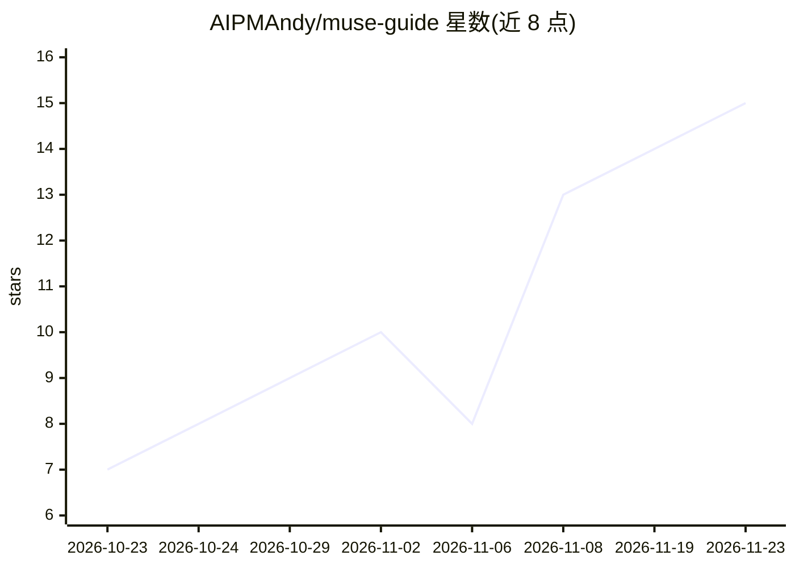

# AIPMAndy/muse-guide

⭐ 15 · HTML · MIT · 推送 2026-11-22 · [GitHub](https://github.com/AIPMAndy/muse-guide) · [官网](https://aipmandy.github.io/muse-guide/) · 个人维护 · 中文 README

**Meta Muse 个人 AI Agent 的非官方中文实战手册**

独立编辑的中文开源手册，针对 Meta Muse 个人 Agent，含 28 章实战、80 条场景化任务指令（16 类）、12 套业务 SOP、12 项安全检查、30 天训练计划与 8 套模板。内容按官方发布与真实账户复现双轨记录，站点功能在浏览器本地运行、无后端，并提供 PDF 电子书与交互式网站。明确声明非 Meta 官方，不提供绕过地区限制的方法。

## 筛选速览

| 维度 | 判定 | 备注 |
|---|---|---|
| AI 角色 | `ai-knowledge` | 知识聚合/清单类 |
| 许可风险 | `permissive` | MIT |
| 部署形态 | `None` |  |
| 模型依赖 | — | README 未给出锁定关系 |
| 硬件要求 | — | 无带数字的原话,不猜 |
| 安装摩擦 | `low` | 无编译、无系统依赖或容器化 |
| 成熟度 | — | 结构信号不足 |

## 能力要点

- 28 章实战 + 80 条任务指令 + 12 套 SOP 的结构化知识库
- 12 项安全检查（授权、注入、共享、写入、回滚、误操作应急）
- 官方功能证据矩阵采用官方发布（O）与真实账户复现（T）双轨记录
- 在线任务书生成器与指令库在浏览器本地运行，无后端不采集输入

## 适用场景

- 中文用户上手 Meta Muse 处理邮件、日历、调研等任务
- 为团队搭建带审批边界与验收指标的业务 SOP
- 参照安全指南检查 Agent 的真实授权与权限
- 求职、内容生产等场景查找可复制的提示词

## 场景标签

`教程课程` `提示工程` `知识库管理` · 领域:Agent 开发

## 证据(README 行号)

> L12: > **一套可验证、能更新、带风险边界的 Meta Muse 个人 AI Agent 中文实战知识库。**
> L23: > **TL;DR｜一句话**：这是 AI 酋长 Andy 编写的非官方 Meta Muse 个人 AI Agent 中文实战手册。适合想用 Muse 处理邮件、日历、调研、内容和求职任务的中文用户。它含 28 章实战、80 条任
> L31: |深度实战章节|**28 章**|从首次上手到安全、系统评估、运营维护|

## 星数曲线

2026-10-23 7 → 2026-11-23 15（+8）

---
*卡片 v1 · prompt 1.4 · 生成 2026-11-18 · 置信度 high · 依据 README sha `d3e7dc7caa8f` · [字段定义](../../DATASET.md)*
