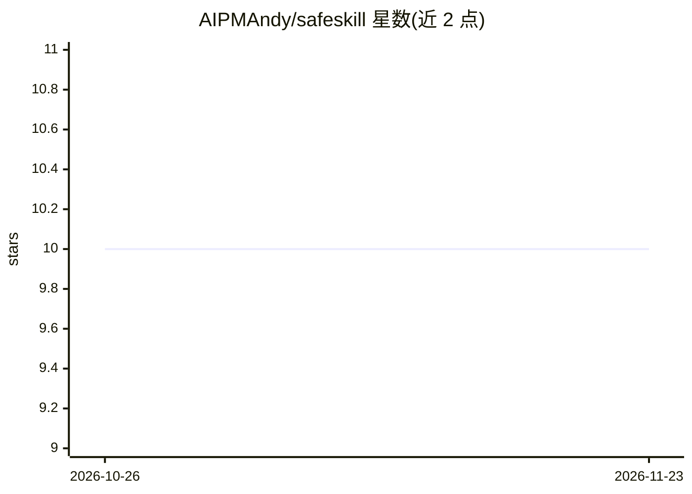

# AIPMAndy/safeskill

⭐ 10 · Python · Apache-2.0 · 推送 2026-11-12 · [GitHub](https://github.com/AIPMAndy/safeskill) · 个人维护 · 中文 README

**给 AI Skill 使用者做的安装前静态安全扫描工具**

SafeSkill 是面向 AI Skill / Agent Skill 的静态安全扫描器（SAST）：输入一个 Skill 目录，扫描代码与配置文件中的危险命令、反向 shell、硬编码凭据、提示词注入、敏感文件访问等模式，输出发现项、风险等级与 0-100 风险分数，支持 text/markdown/json/sarif 报告格式，可通过 .safeskill.yml 自定义规则与排除项，并提供 GitHub Actions 集成示例用于 CI 门禁。适合在安装第三方 Skill 前或提交发布前使用；README 明确说明不能替代完整代码审计，仅覆盖常见高风险模式。

## 筛选速览

| 维度 | 判定 | 备注 |
|---|---|---|
| AI 角色 | `ai-ecosystem` | LLM/agent 周边工具 |
| 许可风险 | `permissive` | Apache-2.0 |
| 部署形态 | `library` | 以包/库形式分发 |
| 模型依赖 | — | README 未给出锁定关系 |
| 硬件要求 | — | 无带数字的原话,不猜 |
| 安装摩擦 | `medium` | 含编译或系统依赖之一 |
| 成熟度 | — | 结构信号不足 |

## 能力要点

- 扫描危险命令、凭据暴露、提示词注入、敏感文件访问等 9 类风险模式
- 输出 text/markdown/json/sarif 四种报告格式与 0-100 风险分数
- .safeskill.yml 配置排除目录、禁用规则与自定义规则
- 提供 GitHub Actions 集成示例，sarif 可上传至 GitHub Code Scanning

## 适用场景

- 安装第三方 Skill 之前先扫一遍风险再决定是否使用
- 把扫描接进 CI/CD，在 PR/push 时做安全门禁
- 平台方对上架市场的 Skill 做发布前筛查
- 批量审计团队内部的 Skill 资产

## 场景标签

`网络安全` · 领域:学习与行业

## 证据(README 行号)

> L36: > **SafeSkill = Skill 的静态安全扫描器（SAST）**
> L177: ### 4) 适合接入 CI/CD

## 星数曲线

2026-10-26 10 → 2026-11-23 10（+0）

---
*卡片 v1 · prompt 1.4 · 生成 2026-11-20 · 置信度 high · 依据 README sha `87d68c66fda0` · [字段定义](../../DATASET.md)*
