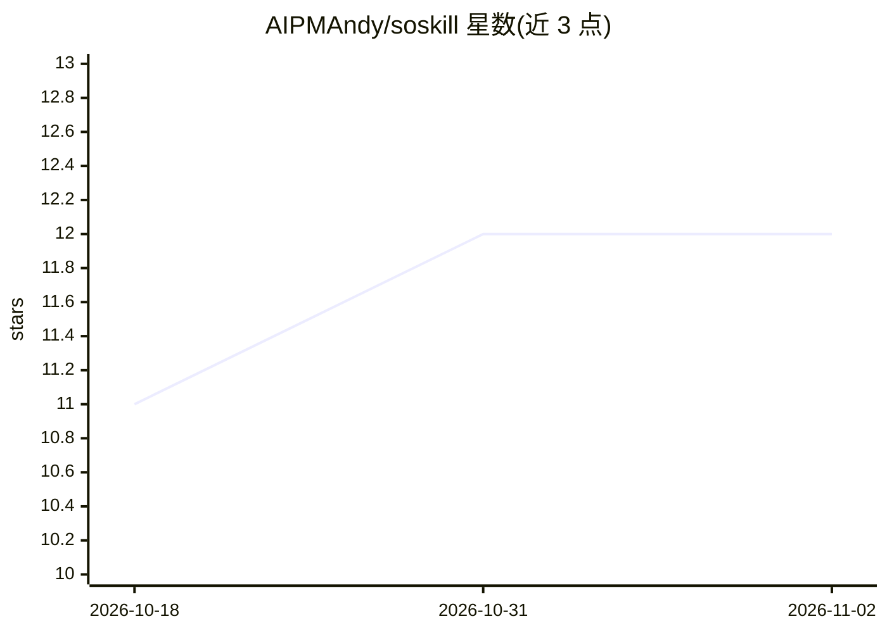

# AIPMAndy/soskill

⭐ 12 · Python · Apache-2.0 · 推送 2026-11-01 · [GitHub](https://github.com/AIPMAndy/soskill) · 个人维护 · 中文 README

**OpenClaw Skill 搜索与推荐工具：按查询匹配开源 Skill**

面向 AI Agent 技能选型的搜索聚合工具：从 GitHub/ClawHub 抓取 2700+ 条 Skill 元数据，基于关键词匹配与多维度评分做推荐排序，支持中英文查询、Top-K 输出、匹配阈值调整与 JSON 格式输出，另提供 Streamlit Web UI（本地运行）。内置安全过滤机制，自动过滤高风险 Skill。作者为个人开发者（前腾讯/百度 AI 产品专家），Apache 2.0 许可。

## 筛选速览

| 维度 | 判定 | 备注 |
|---|---|---|
| AI 角色 | `ai-knowledge` | 知识聚合/清单类 |
| 许可风险 | `permissive` | Apache-2.0 |
| 部署形态 | `None` |  |
| 模型依赖 | — | README 未给出锁定关系 |
| 硬件要求 | — | 无带数字的原话,不猜 |
| 安装摩擦 | `low` | 无编译、无系统依赖或容器化 |
| 成熟度 | — | 结构信号不足 |

## 能力要点

- 聚合 2700+ 开源 Skill 元数据（GitHub/ClawHub）
- 关键词匹配 + 多维度评分，支持中英文查询与 Top-K 推荐
- 自动过滤高风险 Skill
- 提供 CLI 与 Streamlit Web UI 两种使用方式

## 适用场景

- 为 OpenClaw 类 Agent 查找并安装所需 Skill
- 用中英文自然查询快速定位相关 Skill
- 在安装前获得匹配度排序与安全过滤

## 场景标签

 · 领域:AI Agent 工具链/技能检索

## 证据(README 行号)

> L3: AI Skill 搜索引擎 - 3 秒找到你需要的 OpenClaw Skill
> L88: 1. **数据聚合**：从 GitHub/ClawHub 抓取 Skill 元数据
> L89: 2. **智能匹配**：基于关键词匹配 + 多维度评分

## 星数曲线

2026-10-18 11 → 2026-11-02 12（+1）

---
*卡片 v1 · prompt 1.4 · 生成 2026-11-01 · 置信度 high · 依据 README sha `b145d5c3c583` · [字段定义](../../DATASET.md)*
