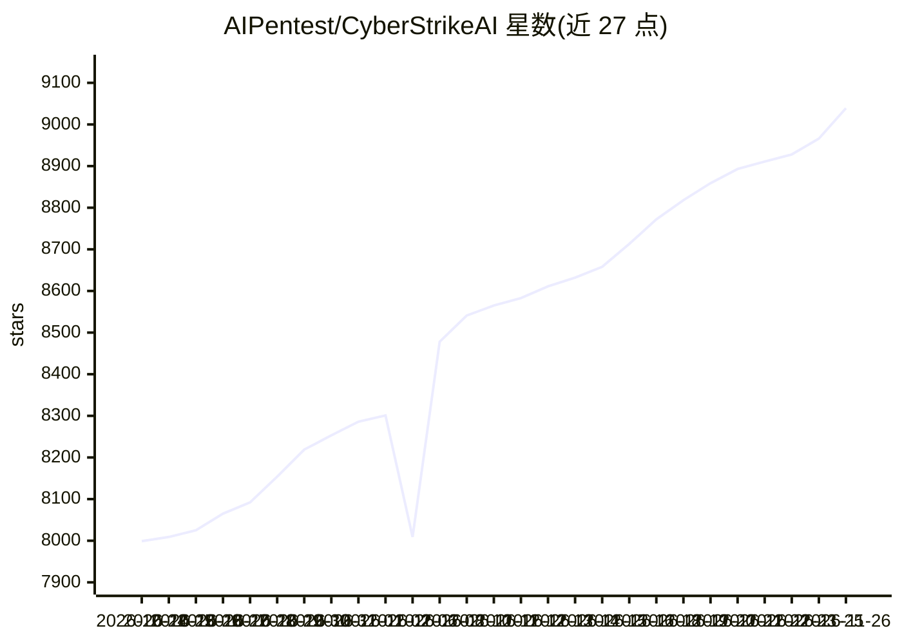

# AIPentest/CyberStrikeAI

⭐ — · [GitHub]() · 个人维护 · 中文 README

**授权安全测试的一体化 AI Agent 工作台**

用 Go 编写的授权安全测试平台，将规划、执行、人工审批、证据留存与回放整合在单一可审计工作区。核心机制包括单 Agent 与 Deep/Plan-Execute/Supervisor 多模式编排、MCP 协议工具接入（HTTP/stdio/SSE/外部联邦）、100+ YAML 安全工具配方、带查询改写与向量检索的知识库，以及图形化工作流与 RBAC 权限。内置 WebShell 管理与 C2，README 要求仅在自有或获授权系统上使用。需 Go 1.25+ 与 Python 3.10+，经 run.sh 一键部署。

## 筛选速览

| 维度 | 判定 | 备注 |
|---|---|---|
| AI 角色 | `ai-native` | 本体是模型或模型工具 |
| 许可风险 | `permissive` | — |
| 部署形态 | `library` | 以包/库形式分发 |
| 模型依赖 | — | README 未给出锁定关系 |
| 硬件要求 | — | 无带数字的原话,不猜 |
| 安装摩擦 | `low` | 无编译、无系统依赖或容器化 |
| 成熟度 | — | 结构信号不足 |

## 能力要点

- 单 Agent 与 Deep/Plan-Execute/Supervisor 多 Agent 编排模式
- MCP 集成支持 HTTP、stdio、SSE、外部联邦与动态工具发现
- 100+ 覆盖杀伤链的安全工具 YAML 配方，含熔断与并发限制的执行治理
- 审批模式、工具白名单、审计日志与攻击链回放

## 适用场景

- 在授权范围内用自然语言驱动渗透测试任务
- 管理漏洞、资产与攻击链的跨会话证据与回放
- 通过图形工作流组合 Agent、工具与审批节点
- 接入 Burp Suite 或浏览器插件辅助 Web 安全测试

## 场景标签

`多智能体` `工作流自动化` `网络安全` · 领域:Agent 开发

## 证据(README 行号)

> L7: **The system of action for AI-native cybersecurity—where intent becomes governed execution, evidence becomes operati
> L9: CyberStrikeAI connects planning, execution, human oversight, evidence, and replay in one auditable workspace. Built 

## 星数曲线

2026-10-24 7,999 → 2026-11-26 9,039（+1,040）

---
*卡片 v1 · prompt 1.4 · 生成 2026-11-24 · 置信度 high · 依据 README sha `d920424e7e7a` · [字段定义](../../DATASET.md)*
