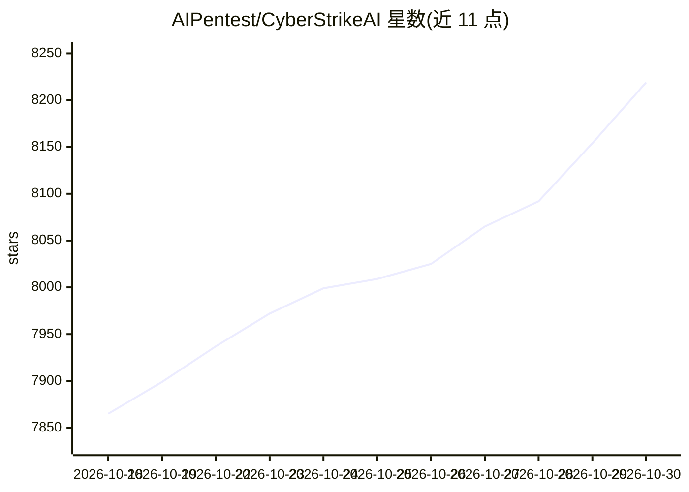

# AIPentest/CyberStrikeAI

⭐ 8,219 · Go · Apache-2.0 · 推送 2026-10-28 · [GitHub](https://github.com/AIPentest/CyberStrikeAI) · 个人维护 · 中文 README

**面向授权安全测试的 AI 原生攻防平台：Go 编写的审计型 agent 工作台**

用 Go 编写、自托管的 AI 网络安全操作平台：以 Eino 编排的 agent（单 agent 及 Deep/Plan-Execute/Supervisor 多 agent 模式）将自然语言意图转为受治理的安全操作，集成 100+ YAML 工具配方与 MCP 工具接入，提供 RAG 知识库、可视化图工作流、WebShell/C2 管理（限授权环境）、资产与漏洞管理、攻击链建模回放，以及人工审批、RBAC 与审计日志。给渗透测试、红队与 CTF 人员使用。通过 run.sh 一键部署（需 Go 1.25+ 与 Python 3.10+，自动构建并启动服务）。

## 筛选速览

| 维度 | 判定 | 备注 |
|---|---|---|
| AI 角色 | `ai-native` | 本体是模型或模型工具 |
| 许可风险 | `permissive` | Apache-2.0 |
| 部署形态 | `library` | 以包/库形式分发 |
| 模型依赖 | — | README 未给出锁定关系 |
| 硬件要求 | — | 无带数字的原话,不猜 |
| 安装摩擦 | `low` | 无编译、无系统依赖或容器化 |
| 成熟度 | — | 结构信号不足 |

## 能力要点

- Eino 多 agent 编排 + 图工作流，将自然语言意图转为可审计安全操作
- 100+ 安全工具 YAML 配方与 MCP（HTTP/stdio/SSE）集成
- 人工审批、调用阻断、RBAC、审计日志等治理机制
- WebShell 管理、内置 C2、攻击链风险评分与逐步回放

## 适用场景

- 授权渗透测试中用自然语言驱动扫描与漏洞利用流程
- 红队/CTF 中跨会话沉淀资产、漏洞与攻击链证据
- 团队多人按角色权限协作并留存操作审计记录

## 场景标签

`网络安全` `多智能体` · 领域:Agent 开发

## 证据(README 行号)

> L9: CyberStrikeAI connects planning, execution, human oversight, evidence, and replay in one auditable workspace. Built 
> L72: - 🤖 **Agentic execution** translates natural-language intent into governed, auditable security actions.

## 星数曲线

2026-10-18 7,865 → 2026-10-30 8,219（+354）

---
*卡片 v1 · prompt 1.4 · 生成 2026-10-20 · 置信度 high · 依据 README sha `933e2ca5dca8` · [字段定义](../../DATASET.md)*
