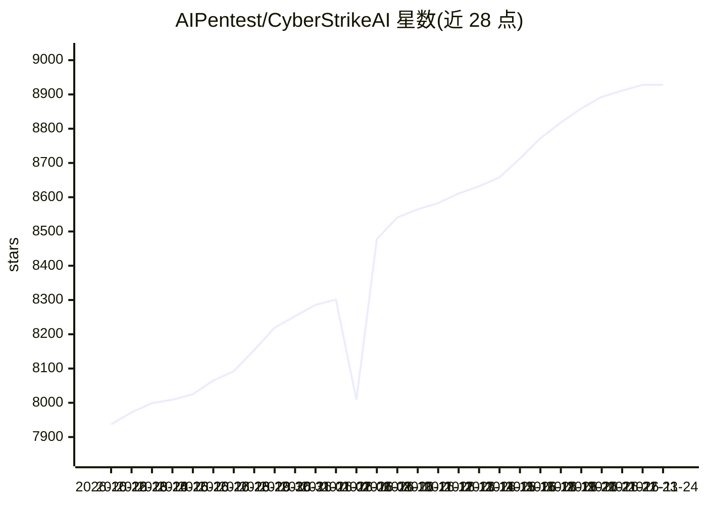

# AIPentest/CyberStrikeAI

⭐ 8,928 · Go · Apache-2.0 · 推送 2026-11-19 · [GitHub](https://github.com/AIPentest/CyberStrikeAI) · 组织维护 · 中文 README

**AI 驱动的授权安全测试工作台：自然语言转换为受控安全操作**

Go 编写的授权安全操作平台，把规划、执行、人工审批、证据留存与回放整合在一个可审计工作区。内置 Pi 编排的单/多 Agent 模式、100+ YAML 格式安全工具配方、MCP 集成、RAG 知识库、可视化工作流与攻击链建模；提供 WebShell 管理、内置 C2 等高风险能力，并配套审批模式、工具白名单、正则调用拦截、RBAC 与审计日志。部署需 Go 1.25+ 与 Python 3.10+，通过 run.sh 一键构建启动，安全工具需自行安装。

## 筛选速览

| 维度 | 判定 | 备注 |
|---|---|---|
| AI 角色 | `ai-native` | 本体是模型或模型工具 |
| 许可风险 | `permissive` | Apache-2.0 |
| 部署形态 | `library` | 以包/库形式分发 |
| 模型依赖 | — | README 未给出锁定关系 |
| 硬件要求 | — | 无带数字的原话,不猜 |
| 安装摩擦 | `low` | 无编译、无系统依赖或容器化 |
| 成熟度 | `idea` | |

## 能力要点

- 单 Agent 与 Deep/Plan-Execute/Supervisor 多 Agent 编排模式
- 100+ 覆盖杀伤链各环节的 YAML 工具配方与 MCP 集成
- 人工审批、工具白名单、正则调用拦截与审计日志等治理机制
- 内置 WebShell 管理与 C2 监听能力（限授权测试）

## 适用场景

- 在自有或授权系统上执行渗透测试与 CTF 练习
- 以自然语言下发安全任务并由多 Agent 编排执行
- 集中管理漏洞、资产与攻击链并逐步回放证据
- 通过企业微信/钉钉/Slack 等聊天机器人接入安全操作

## 场景标签

`网络安全` `多智能体` · 领域:Agent 开发

## 证据(README 行号)

> L9: CyberStrikeAI connects planning, execution, human oversight, evidence, and replay in one auditable workspace. Built 
> L72: - 🤖 **Agentic execution** translates natural-language intent into governed, auditable security actions.
> L79: - 🧰 **Security tools** include 100+ curated YAML recipes with custom extensions and role-scoped access.

## 星数曲线

2026-10-22 7,937 → 2026-11-24 8,928（+991）

---
*卡片 v1 · prompt 1.4 · 生成 2026-11-22 · 置信度 high · 依据 README sha `56af62f3cd68` · [字段定义](../../DATASET.md)*
