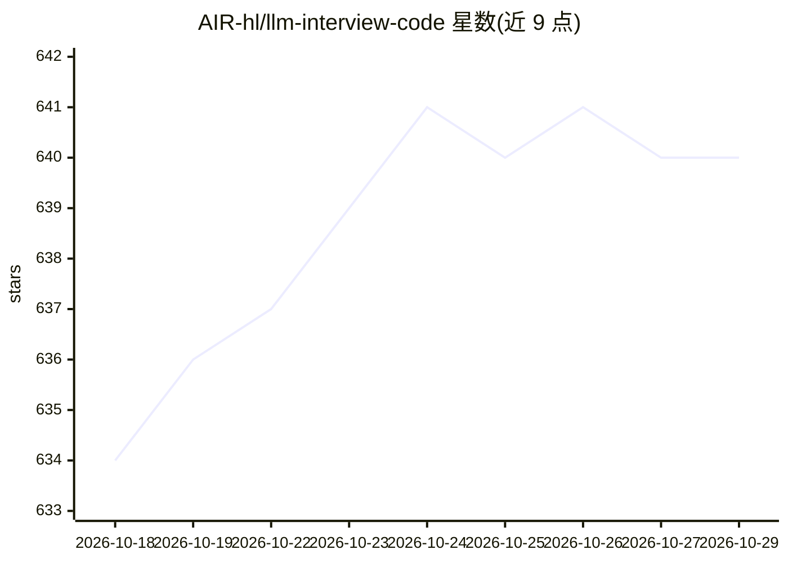

# AIR-hl/llm-interview-code

⭐ 640 · Jupyter Notebook · 推送 2026-06-19 · [GitHub](https://github.com/AIR-hl/llm-interview-code) · 个人维护 · 中文 README

**LLM 面试常见手撕代码合集（注意力/组件/损失/RL 实现）**

以 Jupyter Notebook 形式收录 LLM 面试常见的手写实现代码，按目录组织：Attention（MHA/GQA/MLA/KV cache/掩码）、Components（BPE/LoRA/RoPE/SwGLU/Norm 等）、Functional（激活函数/交叉熵/InfoNCE/量化/SFT/采样/工具调用流式解析）、RL（DPO/GRPO/DAPO/GSPO/KL 散度）。面向准备 LLM 相关面试的开发者与求职者，作者依据自身几十场面试经历标注了高频出现的考点（MHA、RoPE、RMSNorm、BPE、InfoNCE、DPO、工具调用解析）。README 未提供安装运行说明，需自行以 Notebook 方式打开使用。

## 筛选速览

| 维度 | 判定 | 备注 |
|---|---|---|
| AI 角色 | `ai-knowledge` | 知识聚合/清单类 |
| 许可风险 | `none` | — |
| 部署形态 | `None` |  |
| 模型依赖 | — | README 未给出锁定关系 |
| 硬件要求 | — | 无带数字的原话,不猜 |
| 安装摩擦 | `low` | 无编译、无系统依赖或容器化 |
| 成熟度 | — | 结构信号不足 |

## 能力要点

- 覆盖 4 大类 20+ 个 LLM 核心组件的 Notebook 手写实现
- 作者基于几十场面试经历标注高频考点
- 包含 MLA、GQA、DPO/GRPO/DAPO/GSPO 等较新实现

## 适用场景

- 准备 LLM 算法岗面试的手撕代码环节
- 学习 Transformer 组件与 RLHF 损失函数的实现细节
- 对照实现理解 KV cache、量化、采样方法等机制

## 场景标签

`教程课程` · 领域:学习与行业

## 证据(README 行号)

> L3: **LLM面试常见手撕代码合集**
> L9: ## 项目结构

## 星数曲线

2026-10-18 634 → 2026-10-29 640（+6）

---
*卡片 v1 · prompt 1.4 · 生成 2026-10-21 · 置信度 high · 依据 README sha `6c76ee649559` · [字段定义](../../DATASET.md)*
