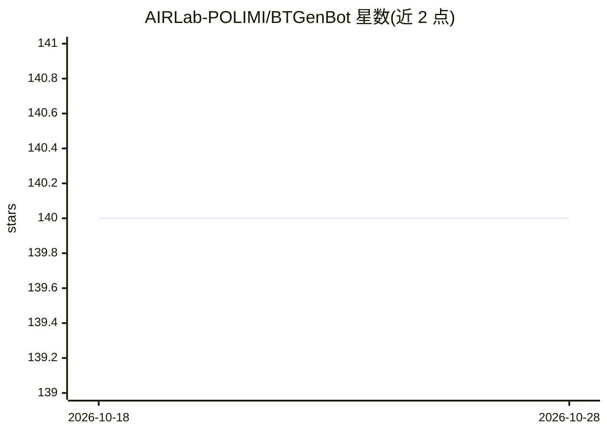

# AIRLab-POLIMI/BTGenBot

⭐ 140 · Jupyter Notebook · MIT · 推送 2026-05-26 · [GitHub](https://github.com/AIRLab-POLIMI/BTGenBot) · 组织维护

**用轻量 LLM 为机器人生成行为树的系统（含执行与校验）**

IROS 2024 论文的代码发布：用不超过 70 亿参数的 LLM（llama2、llama-chat、code-llama，经 LoRA 微调）根据任务描述生成机器人行为树（XML）。包含演示 notebook 加载 HuggingFace 上的微调模型、带 GUI 的 btgenbot.py 生成并经 SSH 传输至机器人、ROS2 bt_client 在机器人上解释执行、bt_validator 校验正确性，以及微调数据集与 LoRA 适配器。基于 Ubuntu 22.04 与 ROS2 Humble 测试，需 colcon 构建与 ROS2 依赖。

## 筛选速览

| 维度 | 判定 | 备注 |
|---|---|---|
| AI 角色 | `ai-native` | 本体是模型或模型工具 |
| 许可风险 | `permissive` | MIT |
| 部署形态 | `library` | 以包/库形式分发 |
| 模型依赖 | — | README 未给出锁定关系 |
| 硬件要求 | — | 无带数字的原话,不猜 |
| 安装摩擦 | `low` | 无编译、无系统依赖或容器化 |
| 成熟度 | — | 结构信号不足 |

## 能力要点

- 轻量 LLM（≤7B，LoRA 微调）生成机器人行为树
- btgenbot.py GUI：标准模式与自动检索 one-shot 模式
- 生成→SSH 传输→ROS2 机器人上执行的完整管线
- 提供数据集、LoRA 适配器与树校验器

## 适用场景

- 用自然语言任务描述生成机器人行为树
- 在 ROS2 机器人上执行 LLM 生成的行为树
- 复现论文的轻量 LLM 行为树生成实验

## 场景标签

`代码生成` `微调` · 领域:编码与开发

## 证据(README 行号)

> L3: This work presents a novel approach to generating
> L34: - `bt_client`: client designed to interpret and execute LLM-generated behavior trees directly on robot
> L35: - `bt_generator`: demo notebook to load our fine-tuned models for generating behavior trees

## 星数曲线

2026-10-18 140 → 2026-10-28 140（+0）

---
*卡片 v1 · prompt 1.4 · 生成 2026-10-23 · 置信度 high · 依据 README sha `2e38ea447419` · [字段定义](../../DATASET.md)*
