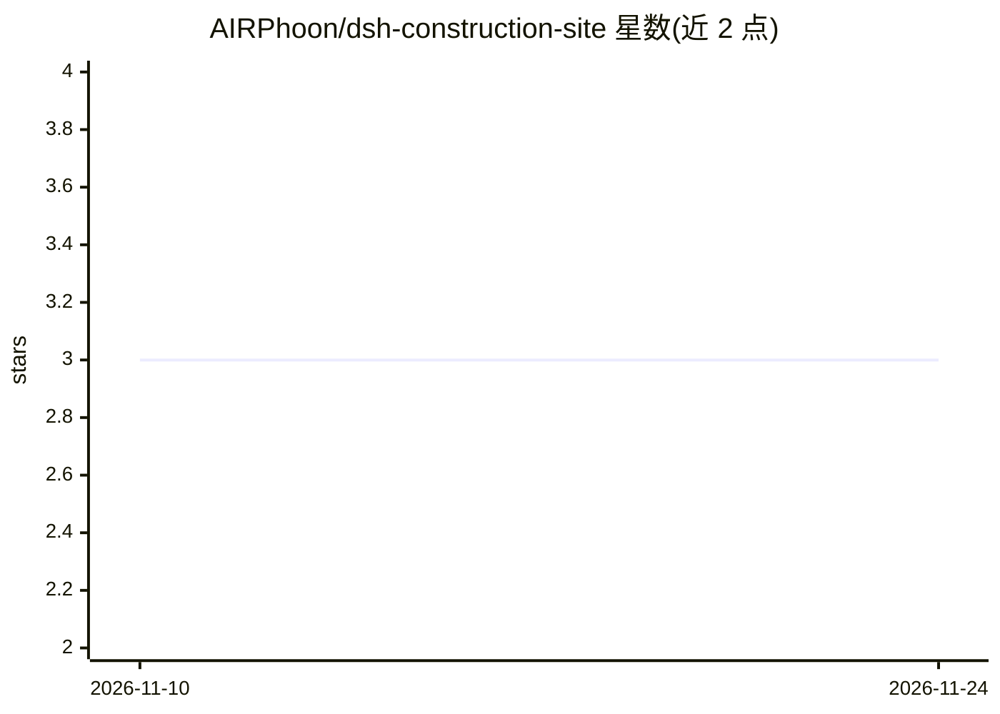

# AIRPhoon/dsh-construction-site

⭐ 3 · TypeScript · NOASSERTION · 推送 2026-11-09 · [GitHub](https://github.com/AIRPhoon/dsh-construction-site) · [官网](https://github.com/AIRPhoon/dsh-construction-site) · 个人维护 · 中文 README

**为 DSH 主 Agent 提供代码审查与模块监督的工作流插件**

DeepSeek Harness 的社区插件（独立于 DeepSeek AI），以施工现场协作隐喻组织质量流程：主 Agent 规划执行，finance 子代理判断是否需要审查并限定范围，function 审计员核对已完成函数，module 监督者检查集成与目标。先规则后模型：精确重复由代码拦截，仅需判断时调用 finance；审查子代理只读、无工具执行权限；审查记录按工作区存储于 $DSH_HOME/quality/v1/。仅接受非商业许可。

## 筛选速览

| 维度 | 判定 | 备注 |
|---|---|---|
| AI 角色 | `ai-ecosystem` | LLM/agent 周边工具 |
| 许可风险 | `none` | NOASSERTION |
| 部署形态 | `None` |  |
| 模型依赖 | — | README 未给出锁定关系 |
| 硬件要求 | — | 无带数字的原话,不猜 |
| 安装摩擦 | `low` | 无编译、无系统依赖或容器化 |
| 成熟度 | — | 结构信号不足 |

## 能力要点

- finance 子代理裁决审查范围：允许/缩小/阻止/索要更多信息
- 审查子代理只读，无代码修改与工具执行权限
- 256 KiB/文件、512 KiB 总量的工作区文件读取与哈希校验
- 审查记录与财务决策按工作区持久化存储

## 适用场景

- 在 DSH 中对完成的函数提交目标、契约与证据做质量审计
- 检查模块间接口与协作是否符合目标
- 按需控制审查范围以减少不必要的模型调用

## 场景标签

`代码审查` · 领域:编码与开发

## 证据(README 行号)

> L7: A construction-site-inspired workflow for DeepSeek Harness: the main Agent plans and executes, finance decides wheth
> L9: Independent community plugin; not affiliated with DeepSeek AI. Category: **Workflow & Automation**.
> L31: - **Function audits:** `quality_review(kind="function")` checks completed functions against their goals, contracts,

## 星数曲线

2026-11-10 3 → 2026-11-24 3（+0）

---
*卡片 v1 · prompt 1.4 · 生成 2026-11-22 · 置信度 high · 依据 README sha `811e74620359` · [字段定义](../../DATASET.md)*
