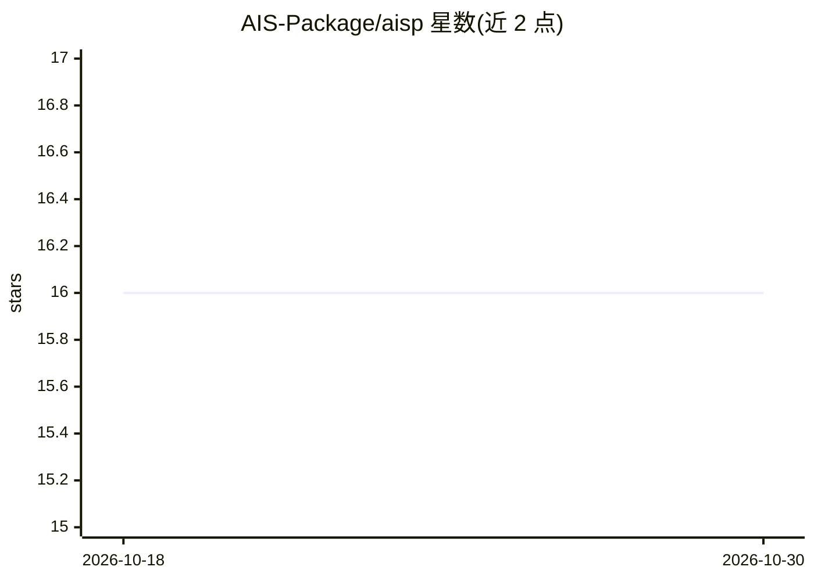

# AIS-Package/aisp

⭐ 16 · Python · LGPL-3.0 · 推送 2026-06-27 · [GitHub](https://github.com/AIS-Package/aisp) · [官网](http://ais-package.github.io/) · 组织维护

**Python 人工免疫系统算法库：异常检测/分类/聚类/优化**

AISP 是实现人工免疫系统（AIS）技术的 Python 包，起于 2022 年 IFNMG-Salinas 的研究项目，以 LGPLv3 分发。提供阴性选择（BNSA/RNSA）、克隆选择（AIRS/CLONALG）、免疫网络（AiNet）等算法，覆盖异常检测、分类、聚类与优化任务；危险理论模块（DCA）处于计划阶段。各算法遵循统一的 fit/predict/optimize 接口，依赖 numpy/scipy/numba，要求 Python 3.10+，可 pip 安装，附示例 notebook 并支持 Binder 在线运行。

## 筛选速览

| 维度 | 判定 | 备注 |
|---|---|---|
| AI 角色 | `ai-native` | 本体是模型或模型工具 |
| 许可风险 | `viral` | LGPL-3.0 |
| 部署形态 | `library` | 以包/库形式分发 |
| 模型依赖 | — | README 未给出锁定关系 |
| 硬件要求 | — | 无带数字的原话,不猜 |
| 安装摩擦 | `low` | 无编译、无系统依赖或容器化 |
| 成熟度 | — | 结构信号不足 |

## 能力要点

- 阴性选择算法 BNSA/RNSA 用于异常检测与分类
- 克隆选择 AIRS/CLONALG 支持分类与优化
- 免疫网络 AiNet 用于聚类与数据压缩
- 统一 fit/predict/optimize 接口

## 适用场景

- 用阴性选择算法做数据异常检测
- 生物启发方法做分类与聚类实验
- 用 CLONALG 求解目标函数优化问题

## 场景标签

 · 领域:机器学习/生物启发计算

## 证据(README 行号)

> L29: AISP provides implementations of bio-inspired algorithms for:
> L31: - **Anomaly detection:** Identify abnormal patterns in data.

## 星数曲线

2026-10-18 16 → 2026-10-30 16（+0）

---
*卡片 v1 · prompt 1.4 · 生成 2026-10-30 · 置信度 high · 依据 README sha `c27a8b31fd13` · [字段定义](../../DATASET.md)*
