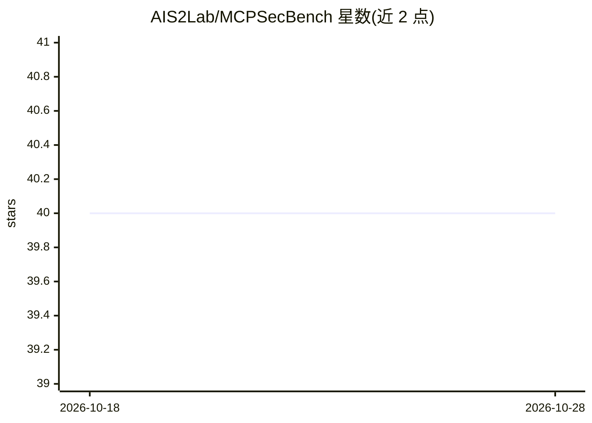

# AIS2Lab/MCPSecBench

⭐ 40 · Python · MIT · 推送 2026-03-04 · [GitHub](https://github.com/AIS2Lab/MCPSecBench) · [官网](https://arxiv.org/abs/2508.13220) · 组织维护

**MCP 安全基准测试套件：测试模型上下文协议的攻击与防护**

面向 Model Context Protocol（MCP）的安全基准与实验环境：提供自动化测试脚本 main.py 与一组正常/恶意 MCP 服务器（计算、签名校验、服务器名称抢占、中间人、DNS 重绑定、CVE-2025-6541 触发），配套客户端支持 OpenAI 与 Claude，可扩展 DeepSeek、Llama、QWen。支持在 CLI、Claude Desktop、Cursor 三种环境下测试，防护选项含 MCIP 与 AIM-MCP。需 Python 3.10+ 与 uv 管理依赖，实验结果存于 data 目录，配套 arXiv 技术报告。

## 筛选速览

| 维度 | 判定 | 备注 |
|---|---|---|
| AI 角色 | `ai-ecosystem` | LLM/agent 周边工具 |
| 许可风险 | `permissive` | MIT |
| 部署形态 | `library` | 以包/库形式分发 |
| 模型依赖 | locked-api |  |
| 硬件要求 | — | 无带数字的原话,不猜 |
| 安装摩擦 | `low` | 无编译、无系统依赖或容器化 |
| 成熟度 | — | 结构信号不足 |

## 能力要点

- 包含 6 类恶意服务器：名称抢占、中间人、DNS 重绑定、CVE-2025-6541 等
- 自动化测试脚本支持 OpenAI 与 Cursor，可测 Claude Desktop
- 防护方案选项：none / MCIP / AIM-MCP
- 客户端支持 OpenAI 与 Claude，可扩展 DeepSeek、Llama、QWen

## 适用场景

- 安全研究者测试 MCP 客户端/服务器在攻击下的表现
- 对比不同防护方案（MCIP、AIM-MCP）对 MCP 攻击的拦截
- 复现论文实验结果或扩展自定义 MCP 客户端测试

## 场景标签

`模型评测` `网络安全` · 领域:评测与运维

## 证据(README 行号)

> L17: - main.py: an automated testing script including part attacks.
> L22: - client.py: client that connect with MCP host and server. At present, it support OpenAI and Claude. It can be exte
> L50: - uv run main.py mode(0 for Claude in CLI mode, 1 for OpenAI, 2 for Cursor) protection(0 for none, 1 for MCIP, 2 fo

## 星数曲线

2026-10-18 40 → 2026-10-28 40（+0）

---
*卡片 v1 · prompt 1.4 · 生成 2026-10-25 · 置信度 mid · 依据 README sha `c1dc5028f5ad` · [字段定义](../../DATASET.md)*
