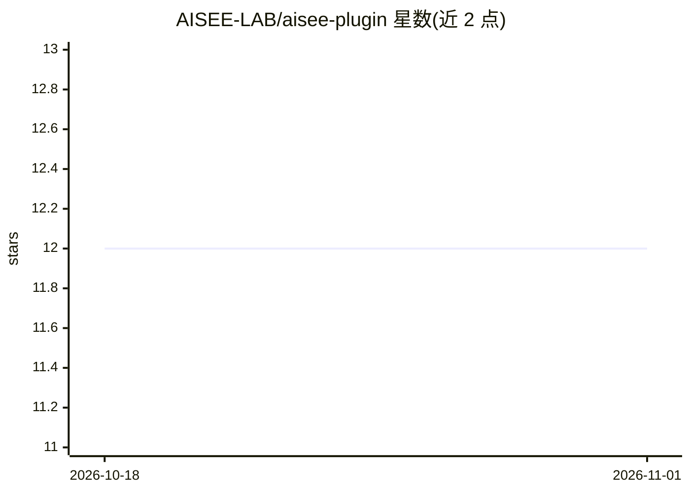

# AISEE-LAB/aisee-plugin

⭐ 12 · Python · MIT · 推送 2026-07-02 · [GitHub](https://github.com/AISEE-LAB/aisee-plugin) · [官网](https://aisee.wiki) · 组织维护 · 中文 README

**面向 OpenSpec 的 AI 软件工程 companion：baseline 迁移与工程记忆**

Aisee Plugin 是面向 Codex 等 coding agent 的 OpenSpec companion 工具集：帮助团队接入 OpenSpec、为已有项目反向整理 baseline specs（spec-migrate）、通过对话澄清需求并生成 change 输入（srs/change-plan/change-author），并提供项目记忆与团队知识 guardrails 的受控检索与写入。它不替代 OpenSpec 的规范状态机，仅做 parser/checker/projector 等辅助。CLI 经 PyPI/pipx 分发，skills 与插件元数据经 Codex marketplace 分发，团队知识功能标注为实验性。

## 筛选速览

| 维度 | 判定 | 备注 |
|---|---|---|
| AI 角色 | `ai-ecosystem` | LLM/agent 周边工具 |
| 许可风险 | `permissive` | MIT |
| 部署形态 | `library` | 以包/库形式分发 |
| 模型依赖 | — | README 未给出锁定关系 |
| 硬件要求 | — | 无带数字的原话,不猜 |
| 安装摩擦 | `low` | 无编译、无系统依赖或容器化 |
| 成熟度 | `idea` | |

## 能力要点

- spec-migrate 从代码/测试/文档整理 OpenSpec baseline specs
- srs→change-plan→change-author 的需求澄清与变更文档生成链路
- 项目记忆与团队知识 guardrails（pack/card 协议）受控检索
- 提供 Codex/Claude/Cursor 等多 agent runtime 的插件元数据

## 适用场景

- 为已有项目建立 OpenSpec baseline 再进入新变更
- 把模糊需求整理成可审查的 OpenSpec change 文档
- 维护仓库级工程记忆供 coding agent 实现前后读取
- 跨项目沉淀并检索已审查的团队工程经验

## 场景标签

`Agent 记忆` · 领域:Agent 开发

## 证据(README 行号)

> L26: Aisee Plugin 是一个面向 OpenSpec 的 AI 软件工程 companion。它帮助团队接入 OpenSpec、为已有项目建立 baseline specs、把模糊意图整理成更清晰的 change 输入，并在实现
> L30: 它尤其适合希望让 Codex 和其他 coding agent 在开源仓库中更稳定协作的维护者：
> L43: ## 为什么这对 Codex 很重要？

## 星数曲线

2026-10-18 12 → 2026-11-01 12（+0）

---
*卡片 v1 · prompt 1.4 · 生成 2026-11-01 · 置信度 mid · 依据 README sha `9d32fa59519b` · [字段定义](../../DATASET.md)*
