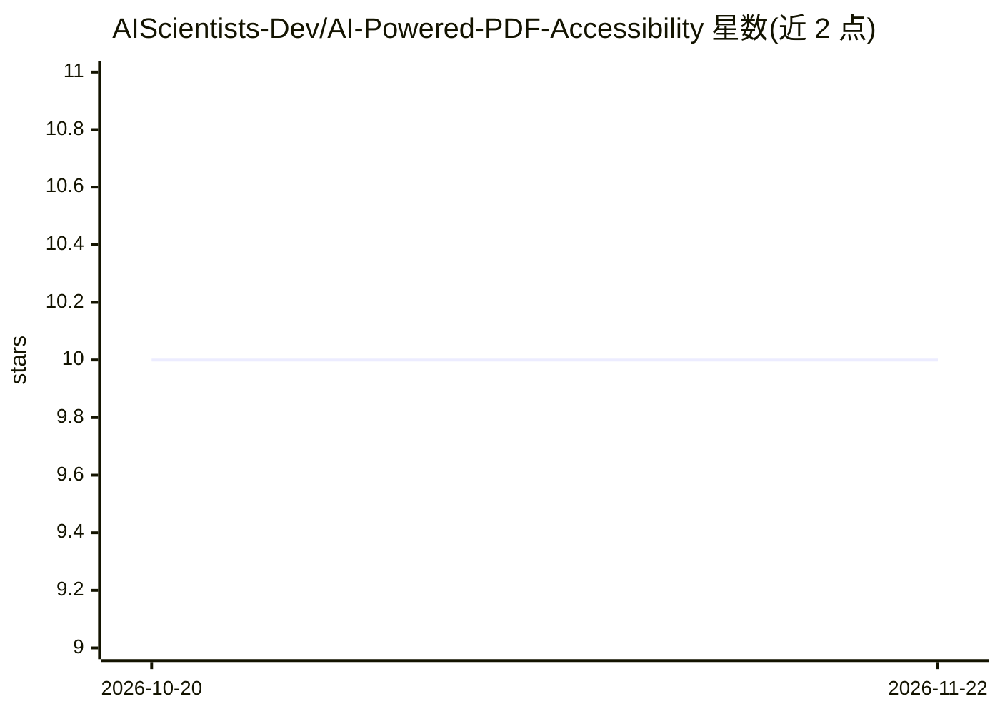

# AIScientists-Dev/AI-Powered-PDF-Accessibility

⭐ 10 · Python · 推送 2026-01-21 · [GitHub](https://github.com/AIScientists-Dev/AI-Powered-PDF-Accessibility) · [官网](https://agentlab.morphmind.ai) · 组织维护

**为 PDF 无障碍改造生成替代文本与结构标注的 MCP 服务**

基于 MCP 协议的 PDF 无障碍修复服务：接收 PDF 或 LaTeX 输入，用 Google Gemini 视觉模型为图像、图表与数学公式生成替代文本，添加标题、段落与阅读顺序等语义结构，并按 PDF/UA（ISO 14289）与 WCAG 2.1 校验、输出 0-100 无障碍评分。提供 25 个专用工具、面向 Agent 的 JSON 端点及标准 HTTP 端点，可本地部署（需 GEMINI_API_KEY），也可通过 MorphMind AgentLab 在线使用。

## 筛选速览

| 维度 | 判定 | 备注 |
|---|---|---|
| AI 角色 | `ai-native` | 本体是模型或模型工具 |
| 许可风险 | `none` | — |
| 部署形态 | `None` |  |
| 模型依赖 | — | README 未给出锁定关系 |
| 硬件要求 | — | 无带数字的原话,不猜 |
| 安装摩擦 | `low` | 无编译、无系统依赖或容器化 |
| 成熟度 | — | 结构信号不足 |

## 能力要点

- AI 视觉生成图像/图表/公式的替代文本
- 25 个专用工具覆盖分析、修复、LaTeX 处理与教学
- PDF/UA 校验并输出 0-100 评分与等级
- 支持 PDF 与 LaTeX 输入，输出可访问 PDF 或修改后的 LaTeX 源码

## 适用场景

- 批量修复文档库中缺少替代文本的 PDF 以满足 PDF/UA 要求
- 为 Agent 工作流提供 PDF 无障碍校验与修复工具
- 处理 LaTeX 生成的文档并输出可访问版本

## 场景标签

`文档解析` · 领域:知识与检索

## 证据(README 行号)

> L10:  Supports PDF and LaTeX input — outputs accessible PDF or modified LaTeX source.
> L11:  Uses AI vision to generate alt-text for images, charts, and math formulas.
> L79: - **MCP** (Model Context Protocol) - Open standard for AI tool integration

## 星数曲线

2026-10-20 10 → 2026-11-22 10（+0）

---
*卡片 v1 · prompt 1.4 · 生成 2026-11-20 · 置信度 high · 依据 README sha `bfd15b01229b` · [字段定义](../../DATASET.md)*
