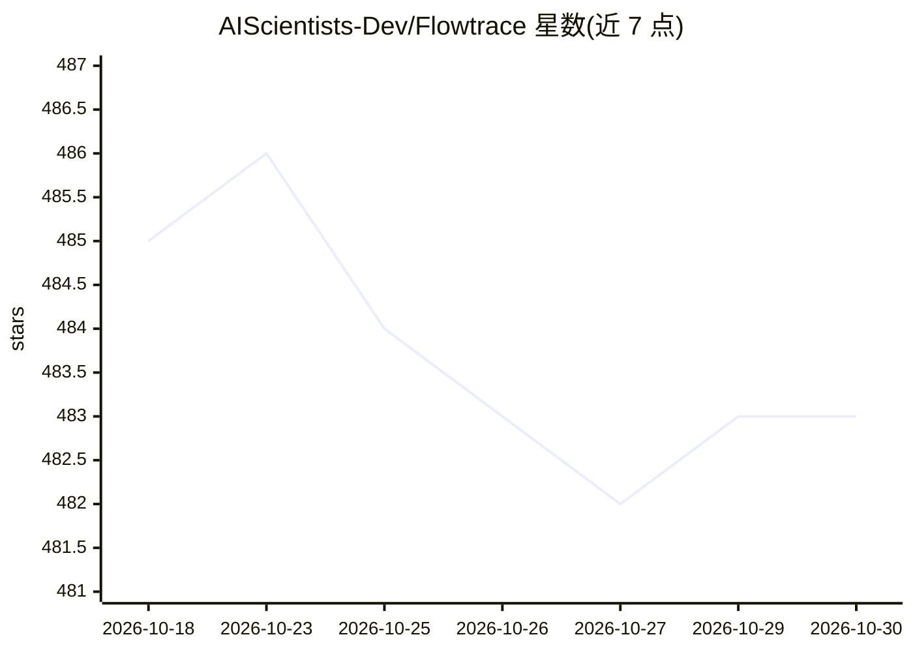

# AIScientists-Dev/Flowtrace

⭐ 483 · TypeScript · MIT · 推送 2026-06-09 · [GitHub](https://github.com/AIScientists-Dev/Flowtrace) · [官网](https://morphmind.ai) · 组织维护 · 中文 README

**把 agent 的工作流转为可留存、可复用、可逐步验证的 trace 工具**

面向使用 Claude Code、Codex、Cursor 等 coding agent 的开发者，把原本一次性完成的对话式任务改写为 trace：一组按依赖依次执行的步骤，每步输出落盘为文件，整个 trace 是一个 git 仓库，每次 CLI 写入生成一次 commit 作为审计记录。步骤间通过文件而非参数传递数据；修改某一步仅重跑其下游依赖；完成的任务可作为 trace 在新输入上复用。提供 CLI 与本地 web 视图（localhost:3000），附 make-trace 技能可将 SKILL.md、runbook、聊天记录等来源转换为 trace，另含九个示例。

## 筛选速览

| 维度 | 判定 | 备注 |
|---|---|---|
| AI 角色 | `ai-ecosystem` | LLM/agent 周边工具 |
| 许可风险 | `permissive` | MIT |
| 部署形态 | `None` |  |
| 模型依赖 | — | README 未给出锁定关系 |
| 硬件要求 | — | 无带数字的原话,不猜 |
| 安装摩擦 | `low` | 无编译、无系统依赖或容器化 |
| 成熟度 | — | 结构信号不足 |

## 能力要点

- 步骤化 trace：每步输出落盘为文件，可逐步检查
- trace 即 git 仓库，每次 CLI 写入对应一次 commit 审计记录
- 修改单步仅重跑其依赖步骤，其余保留
- make-trace 技能把 SKILL.md/runbook/聊天记录转为 trace，附九个领域示例

## 适用场景

- 让 agent 执行需要验证的高风险任务（尽调、安全门、投资决策）并留存证据链
- 把成功的任务运行固化为可复用流程，换新数据重跑
- 回溯任一步骤的历史版本，查看当时的中间产出

## 场景标签

`工作流自动化` · 领域:效率与自动化

## 证据(README 行号)

> L7: Works with the agent you already use: Claude Code, Codex, Cursor.
> L26: Flowtrace runs that same work as a trace: a flow of steps the agent moves through one at a time, each leaving its o
> L74: The fast path is to hand the repo to an agent. Point a coding agent (Claude Code, Codex, Cursor) at this folder and

## 星数曲线

2026-10-18 485 → 2026-10-30 483（-2）

---
*卡片 v1 · prompt 1.4 · 生成 2026-10-21 · 置信度 high · 依据 README sha `fa2ead53969e` · [字段定义](../../DATASET.md)*
