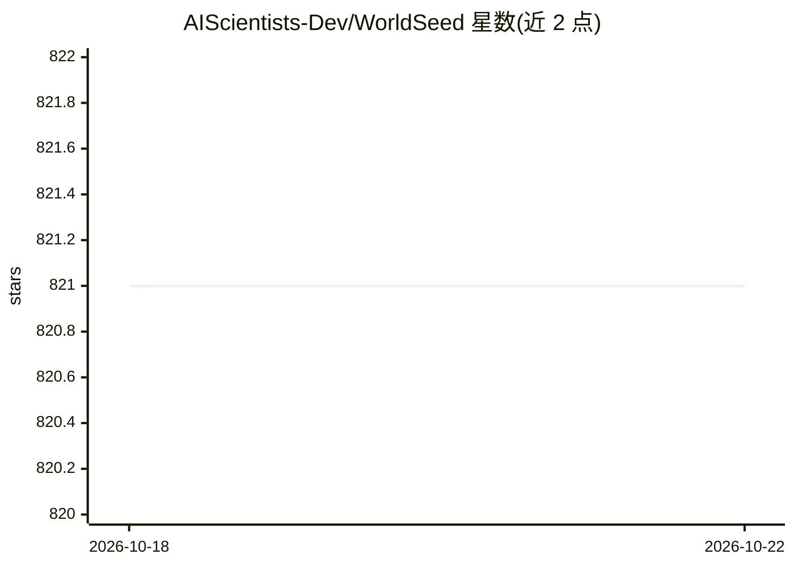

# AIScientists-Dev/WorldSeed

⭐ 821 · Python · MIT · 推送 2026-05-08 · [GitHub](https://github.com/AIScientists-Dev/WorldSeed) · [官网](https://worldseed.morphmind.ai/demo) · 组织维护 · 中文 README

**多智能体世界引擎：用 YAML 定义规则驱动 AI 智能体涌现交互**

WorldSeed 是一个多智能体世界引擎：用单个 YAML 文件声明实体、规则、物理与每角色感知过滤，引擎以 tick 循环推进——确定性行为由 YAML 内 DSL 规则引擎解析，不确定行为交由 LLM Dungeon Master 裁决并返回结构化效果。用户可旁观、干预或扮演角色。智能体可接入 OpenClaw 或 Codex subagents，DM 可用任何 LiteLLM 支持的模型。内置自动科研、AI 裁员、茶馆谍战等示例场景。运行需 Python 3.11+、Node.js 18+、uv，从源码克隆构建后经 dashboard 访问。

## 筛选速览

| 维度 | 判定 | 备注 |
|---|---|---|
| AI 角色 | `ai-ecosystem` | LLM/agent 周边工具 |
| 许可风险 | `permissive` | MIT |
| 部署形态 | `library` | 以包/库形式分发 |
| 模型依赖 | — | README 未给出锁定关系 |
| 硬件要求 | — | 无带数字的原话,不猜 |
| 安装摩擦 | `low` | 无编译、无系统依赖或容器化 |
| 成熟度 | — | 结构信号不足 |

## 能力要点

- YAML 声明世界，tick 循环驱动，规则引擎零硬编码领域知识
- DSL 处理确定性行为，LLM Dungeon Master 裁决不确定行为
- 按角色过滤感知，实现不对称信息设计
- 支持 OpenClaw/Codex subagents 智能体与任意 LiteLLM 模型作 DM

## 适用场景

- 搭建多智能体自动科研或工具评测等模拟场景
- 观察并干预 AI 智能体群体的涌现行为
- 扮演一个角色与 AI 智能体共同推进剧情
- 从提示生成世界 YAML 后手工调整规则与角色配置

## 场景标签

`多智能体` · 领域:Agent 开发

## 证据(README 行号)

> L113: WorldSeed runs on a tick loop over a world you declared in YAML. A **tick** is one beat of the world's clock, like
> L129: - **Bring your own agents.** OpenClaw or Codex subagents.
> L130: - **Any LLM can be the DM.** Works with any LiteLLM-supported model.

## 星数曲线

2026-10-18 821 → 2026-10-22 821（+0）

---
*卡片 v1 · prompt 1.4 · 生成 2026-10-21 · 置信度 high · 依据 README sha `e1e1782ec989` · [字段定义](../../DATASET.md)*
