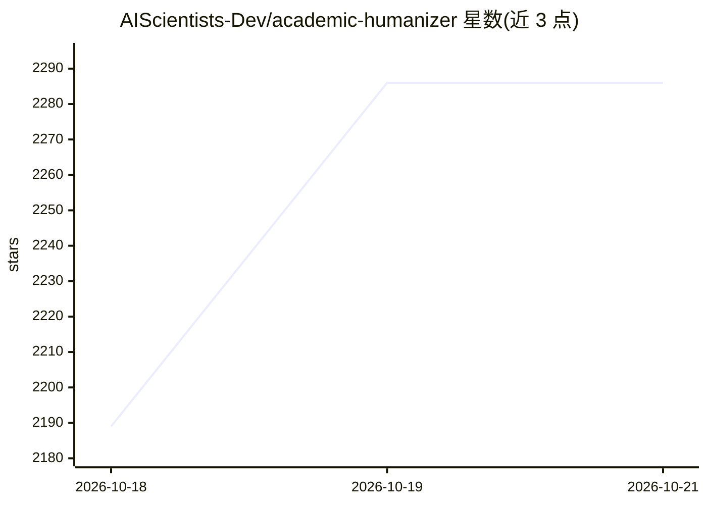

# AIScientists-Dev/academic-humanizer

⭐ 2,415 · NOASSERTION · 推送 2026-07-03 · [GitHub](https://github.com/AIScientists-Dev/academic-humanizer) · [官网](https://morphmind.ai) · 组织维护

**给科研作者的 AI 草稿润色技能：去 AI 腔、保学术措辞与引证**

面向论文与基金申请（NSF/NIH）的编辑辅助技能，以纯 SKILL.md 加示例形式提供，可安装为 Claude Code 技能，或作为 Codex、MorphMind 的技能/系统提示词。通过六层机制工作：通用 AI 痕迹目录、学术特定痕迹、保留学术惯例、声明与证据对齐、作者声线与目标刊物校准、基金申请模式（重视前几页）。声明不改动数字、引文与参考文献，不用于规避 AI 检测，并提醒遵守投稿场所的披露政策。

## 筛选速览

| 维度 | 判定 | 备注 |
|---|---|---|
| AI 角色 | `ai-ecosystem` | LLM/agent 周边工具 |
| 许可风险 | `none` | NOASSERTION |
| 部署形态 | `None` |  |
| 模型依赖 | locked-api |  |
| 硬件要求 | — | 无带数字的原话,不猜 |
| 安装摩擦 | `low` | 无编译、无系统依赖或容器化 |
| 成熟度 | — | 结构信号不足 |

## 能力要点

- 削减通用 AI 措辞（如 In recent years、delve、三段式排比等）
- 声明与证据对齐：动词强度不超过数据（prove→show empirically）
- NSF/NIH 基金申请独立模式，保留愿景并聚焦前几页
- 可指向作者既往论文做声线校准，支持 fork 自定义规则

## 适用场景

- 我把 AI 辅助写的论文草稿改成自己以前的写作风格
- 润色 NSF/NIH 基金申请，让前几页更聚焦评审关注点
- 在保持数字、引文和学术措辞不变的前提下清理 AI 腔

## 场景标签

`AI 写作` `科研工具` `提示工程` · 领域:Agent 开发

## 证据(README 行号)

> L66: git clone https://github.com/AIScientists-Dev/academic-humanizer ~/.claude/skills/academic-humanizer
> L69: It is a plain `SKILL.md` plus examples, so it also runs as a skill or system prompt for **Codex** and

## 星数曲线

2026-10-18 2,189 → 2026-10-21 2,286（+97）

---
*卡片 v1 · prompt 1.4 · 生成 2026-10-21 · 置信度 high · 依据 README sha `8779c4e76b43` · [字段定义](../../DATASET.md)*
