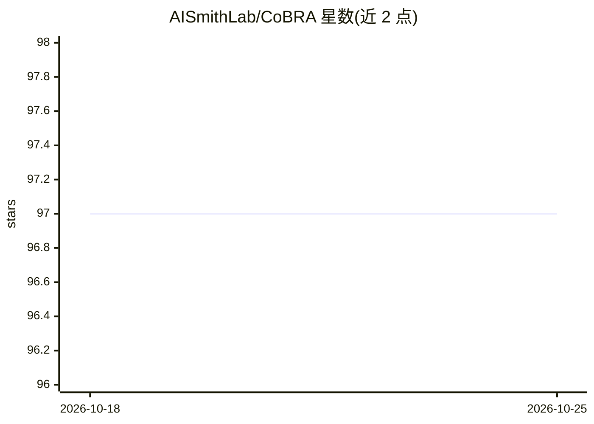

# AISmithLab/CoBRA

⭐ 97 · Python · MIT · 推送 2026-04-21 · [GitHub](https://github.com/AISmithLab/CoBRA) · [官网](https://cobra.clawder.ai/) · 组织维护 · 中文 README

**科研工具包：用经典社科实验测量并调控 LLM agent 的认知偏差**

面向研究者的 LLM 社会模拟行为控制工具包：以经验证的经典社会科学实验（Milgram、Asch 线条、Wanson 选择、亚洲疾病等）作为可复用的评测"gym"环境，量化社会 agent 的认知偏差强度（Cognitive Bias Index，0-4 量表），并通过行为调控引擎按三种方式（提示工程、表征工程、微调）将 agent 行为对齐到指定的偏差水平。支持权威效应、从众效应、确认偏差、框架效应四类偏差，提供统一流水线一条命令跑完整实验、消融研究与自定义偏差场景生成器。安装方式为 pip 安装依赖后从源码运行。

## 筛选速览

| 维度 | 判定 | 备注 |
|---|---|---|
| AI 角色 | `ai-ecosystem` | LLM/agent 周边工具 |
| 许可风险 | `permissive` | MIT |
| 部署形态 | `library` | 以包/库形式分发 |
| 模型依赖 | — | README 未给出锁定关系 |
| 硬件要求 | — | 无带数字的原话,不猜 |
| 安装摩擦 | `low` | 无编译、无系统依赖或容器化 |
| 成熟度 | `idea` | |

## 能力要点

- 认知偏差指数：以经典社科实验量化 agent 偏差强度（0-4 量表）
- 行为调控引擎支持提示工程/表征工程/微调三种控制方法
- 覆盖 4 类偏差、8 种实验范式，附统一实验流水线与消融研究
- 提供自定义偏差场景与响应的数据生成器

## 适用场景

- 让 LLM 社会模拟中的 agent 呈现指定水平且跨模型一致的认知偏差
- 量化比较不同模型/人格/温度设置下的偏差表现
- 构建受控的社会科学与情感模拟实验环境

## 场景标签

`科研工具` `模型评测` · 领域:评测与运维

## 证据(README 行号)

> L26: **CoBRA** (**Co**gnitive **B**ias **R**egulator for Social **A**gents) is a novel toolkit that lets researchers exp
> L34: **At the heart of CoBRA is a novel closed-loop system with two core components:**
> L35: - **Cognitive Bias Index** — measures the cognitive bias of a social agent by quantifying its reactions in validate

## 星数曲线

2026-10-18 97 → 2026-10-25 97（+0）

---
*卡片 v1 · prompt 1.4 · 生成 2026-10-23 · 置信度 high · 依据 README sha `3ca1ac77186f` · [字段定义](../../DATASET.md)*
