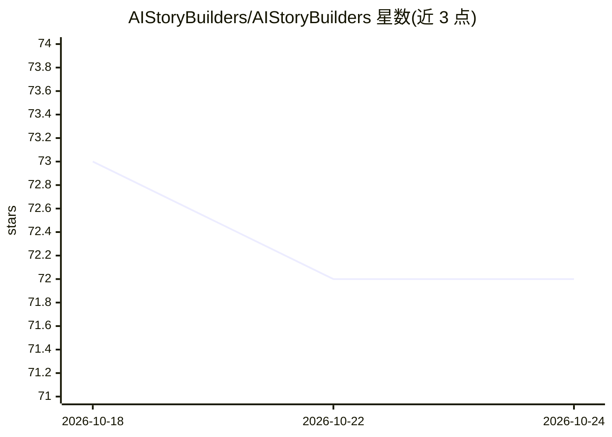

# AIStoryBuilders/AIStoryBuilders

⭐ 72 · C# · MIT · 推送 2026-06-20 · [GitHub](https://github.com/AIStoryBuilders/AIStoryBuilders) · [官网](https://aistorybuilders.com/) · 个人维护

**借助 LLM 组织故事要素、辅助小说写作的应用**

面向小说作者的写作应用，将作品组织为 Story、Timelines、Locations、Characters、Chapters 等结构化数据，通过 LLM 辅助写作。提供在线版本（online.aistorybuilders.com）及 Microsoft Store 安装包，仓库另含 AIOrchestrator 子项目与在线版源码仓库链接。README 未展示模型接入细节与具体写作功能流程，README 以数据结构说明为主。

## 筛选速览

| 维度 | 判定 | 备注 |
|---|---|---|
| AI 角色 | `ai-native` | 本体是模型或模型工具 |
| 许可风险 | `permissive` | MIT |
| 部署形态 | `None` |  |
| 模型依赖 | — | README 未给出锁定关系 |
| 硬件要求 | — | 无带数字的原话,不猜 |
| 安装摩擦 | `low` | 无编译、无系统依赖或容器化 |
| 成熟度 | — | 结构信号不足 |

## 能力要点

- 以 Story/Timelines/Locations/Characters/Chapters 结构化组织小说内容
- 提供在线版本与 Microsoft Store 安装包
- 含 AIOrchestrator 子项目与在线版源码仓库

## 适用场景

- 写小说时用 AI 辅助续写和组织情节
- 按时间线、地点、角色管理复杂故事设定

## 场景标签

`AI 写作` · 领域:内容生成

## 证据(README 行号)

> L4: Write your next novel faster and easier.
> L22: * AIOrchestrator

## 星数曲线

2026-10-18 73 → 2026-10-24 72（-1）

---
*卡片 v1 · prompt 1.4 · 生成 2026-10-24 · 置信度 mid · 依据 README sha `c23e7f064ef6` · [字段定义](../../DATASET.md)*
