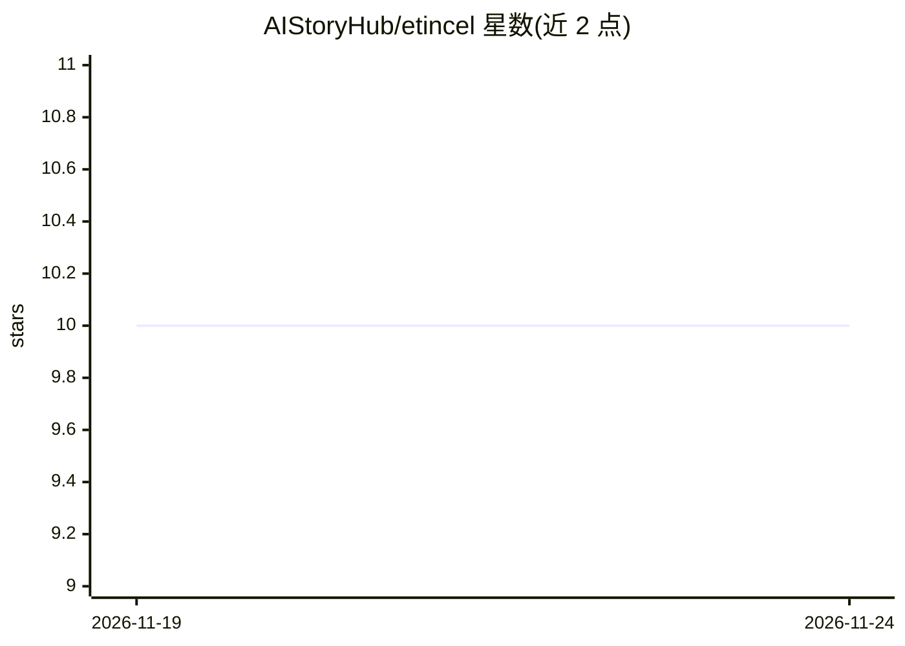

# AIStoryHub/etincel

⭐ 10 · TypeScript · MIT · 推送 2026-08-15 · [GitHub](https://github.com/AIStoryHub/etincel) · [官网](https://etincel.ai) · 个人维护

**检测 AI 痕迹文风的本地确定性审计工具，含 MCP/CLI/CI**

面向非虚构写作的 AI 痕迹检查器：核心是基于规则的确定性扫描器 audit_text，逐条报告机器写作模式的位置与严重度，全程无模型调用、无网络；按 docs/blog/memo/essay 等文体分别用标注语料测得 AUC 并公布数值。同时作为 MCP 服务器（20 个工具）向 Claude Code、Claude Desktop、Cursor 等客户端提供文风预设与个人文风训练指令，并在 CI 中以 GitHub Action 形式拦截超标提交。另提供托管版 etincel.ai，但不属于本仓库。

## 筛选速览

| 维度 | 判定 | 备注 |
|---|---|---|
| AI 角色 | `ai-ecosystem` | LLM/agent 周边工具 |
| 许可风险 | `permissive` | MIT |
| 部署形态 | `library` | 以包/库形式分发 |
| 模型依赖 | locked-api |  |
| 硬件要求 | — | 无带数字的原话,不猜 |
| 安装摩擦 | `low` | 无编译、无系统依赖或容器化 |
| 成熟度 | — | 结构信号不足 |

## 能力要点

- 确定性规则扫描 AI 写作痕迹，无模型调用、无网络、可在 CI 运行
- 公布按文体校准的 AUC 数值（memo 0.909 / essay 0.900 等）并随 CI 追踪回归
- MCP 服务器提供 20 个工具：文风预设、从个人样本训练文风、voice match 检查
- 支持 .etincelrc 仓库级配置与 ETINCEL_HOME 团队共享目录

## 适用场景

- 在 CI 中 lint README、docs 与 PR 描述里的 AI 文风问题
- 让 Claude Code/Cursor 按自己训练的文风起草文章
- 团队通过仓库配置统一禁用词与共用文风

## 场景标签

 · 领域:开发工具/写作质量检查

## 证据(README 行号)

> L25: Étincel is two things. A **deterministic audit** that finds the patterns making prose read as machine-written, as a
> L27: AI-drafted prose has a recognizable shape: uniform paragraphs, hedged authority, em dashes where a comma would do, 
> L164: - **An MCP server** (`src/server.ts`) exposing twenty tools:

## 星数曲线

2026-11-19 10 → 2026-11-24 10（+0）

---
*卡片 v1 · prompt 1.4 · 生成 2026-11-20 · 置信度 high · 依据 README sha `5ae6fd729f05` · [字段定义](../../DATASET.md)*
