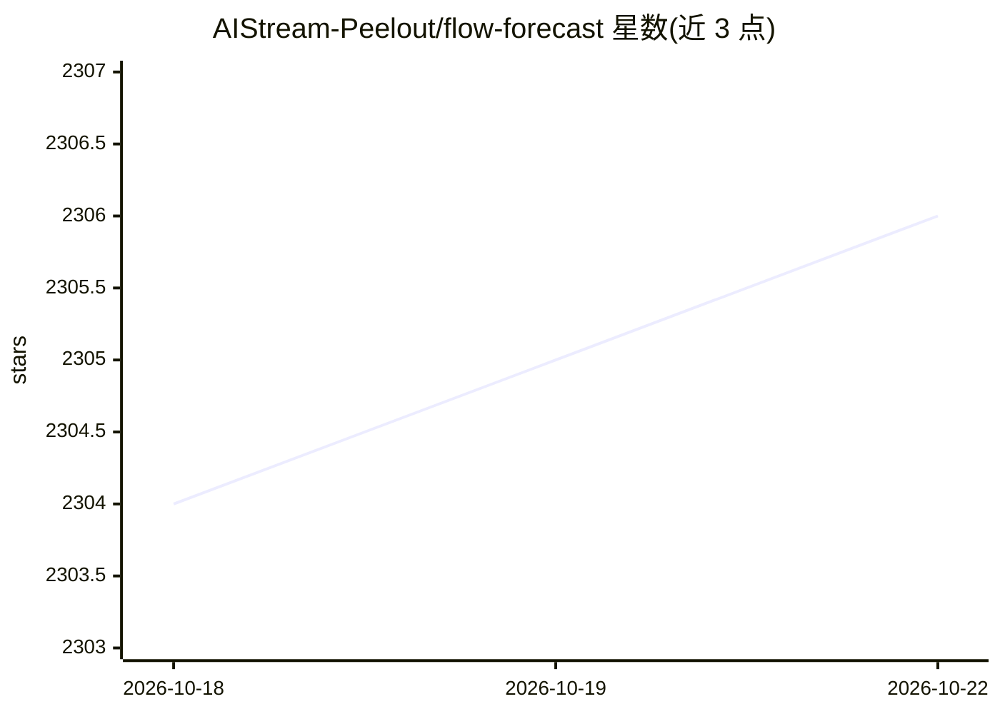

# AIStream-Peelout/flow-forecast

⭐ 2,307 · Python · GPL-3.0 · 推送 2026-10-12 · [GitHub](https://github.com/AIStream-Peelout/flow-forecast) · [官网](https://flow-forecast.atlassian.net/wiki/spaces/FF/overview) · 组织维护

**面向开发者的 PyTorch 时间序列预测/分类/异常检测库**

基于 PyTorch 的时间序列深度学习库，最初为洪水与河流流量预测提供开源基准和代码，现由 Task-TS（CoronaWhy）主要维护。提供 17 种模型（LSTM、Transformer 变体、Informer、DeepAR、DLinear、Crossformer、Anomaly Transformer 等），支持预测、分类与异常检测三类任务，并提供云平台集成（Google Cloud）、Weights and Biases 实验跟踪与模型服务能力。通过 pip 以 flood-forecast 包名安装，训练细节依赖 Wiki 与 Confluence 文档。

## 筛选速览

| 维度 | 判定 | 备注 |
|---|---|---|
| AI 角色 | `ai-native` | 本体是模型或模型工具 |
| 许可风险 | `viral` | GPL-3.0 |
| 部署形态 | `library` | 以包/库形式分发 |
| 模型依赖 | — | README 未给出锁定关系 |
| 硬件要求 | — | 无带数字的原话,不猜 |
| 安装摩擦 | `low` | 无编译、无系统依赖或容器化 |
| 成熟度 | — | 结构信号不足 |

## 能力要点

- 17 种模型覆盖预测/分类/异常检测三类任务
- 提供 Google Cloud Platform 与 Weights and Biases 集成
- 历史上为洪水与河流流量预测提供开源基准数据与代码
- 以 pip 包 flood-forecast 形式发布，配有 CI 与文档站

## 适用场景

- 用 LSTM/Transformer 等模型做多变量时间序列预测
- 时间序列异常检测与分类任务建模
- 河流流量与洪水严重度的历史基准研究
- 通过 Weights and Biases 跟踪时间序列实验

## 场景标签

 · 领域:时间序列深度学习

## 证据(README 行号)

> L1: # Deep learning for time series forecasting, classification, and anomaly detection
> L3: Flow Forecast (FF) is an open-source deep learning for time series forecasting framework. It provides all the latest

## 星数曲线

2026-10-18 2,304 → 2026-10-22 2,306（+2）

---
*卡片 v1 · prompt 1.4 · 生成 2026-10-21 · 置信度 high · 依据 README sha `b28e17536925` · [字段定义](../../DATASET.md)*
