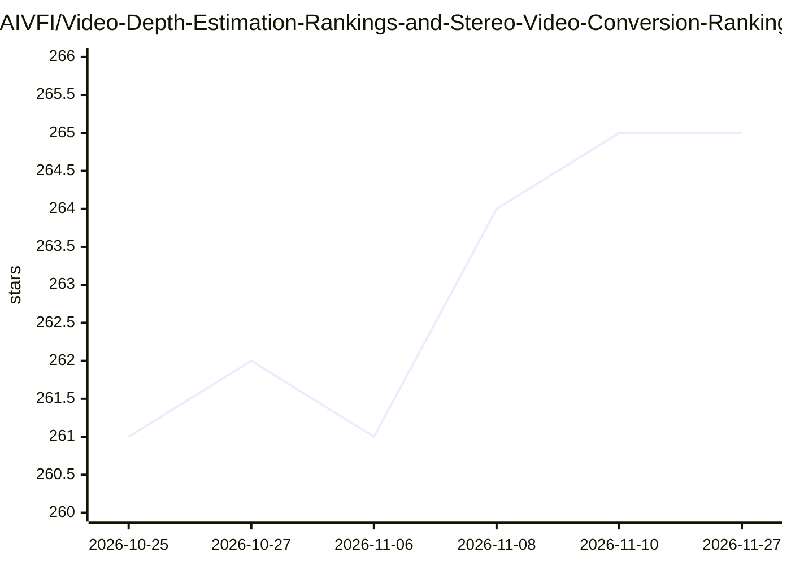

# AIVFI/Video-Depth-Estimation-Rankings-and-Stereo-Video-Conversion-Rankings

⭐ 265 · 推送 2026-10-26 · [GitHub](https://github.com/AIVFI/Video-Depth-Estimation-Rankings-and-Stereo-Video-Conversion-Rankings) · 个人维护

**视频深度估计与立体视频转换模型的排名与数据集清单**

面向深度估计与立体视频转换研究者的聚合清单：收录 2025 年 4 月至 2026 年 10 月的立体视频转换方法列表（含 backbone、arXiv 时间、会议与代码仓库链接），整理 56 个可用于训练/测试 HD 视频深度估计的合成 RGB-D 视频数据集（标注分辨率、发表 venue 及各模型使用情况 T/E），另含 2 个合成 RGB-D 图像数据集与单图像深度估计排名表；并标注部分数据集需谨慎核查或不建议使用。附录用计划收录排名/指标选择规则与相关论文列表。

## 筛选速览

| 维度 | 判定 | 备注 |
|---|---|---|
| AI 角色 | `ai-knowledge` | 知识聚合/清单类 |
| 许可风险 | `none` | — |
| 部署形态 | `None` |  |
| 模型依赖 | — | README 未给出锁定关系 |
| 硬件要求 | — | 无带数字的原话,不猜 |
| 安装摩擦 | `low` | 无编译、无系统依赖或容器化 |
| 成熟度 | — | 结构信号不足 |

## 能力要点

- 近 19 个月立体视频转换方法汇总表（backbone/venue/仓库链接）
- 56 个合成 RGB-D 视频数据集清单，标注分辨率与训练/评测使用情况
- 标注不建议使用与需谨慎核查的数据集并给出原因
- 按 ScanNet/Bonn 等基准组织的深度估计排名表

## 适用场景

- 为新模型选择训练用的合成 RGB-D 视频数据集
- 查找立体视频转换方法的官方仓库与发表信息
- 对比各深度估计模型在公开基准上的指标

## 场景标签

`模型评测` `精选清单` · 领域:评测与运维

## 证据(README 行号)

> L31: The following list includes **all Stereo Video Conversion methods from the last 19 months, from 1 April 2025 to 12 
> L50: ## Awesome Synthetic RGB-D Image Datasets for Training HD Video Depth Estimation Models
> L59: ## Awesome Synthetic RGB-D Video Datasets for Training and Testing HD Video Depth Estimation Models

## 星数曲线

2026-10-25 261 → 2026-11-27 265（+4）

---
*卡片 v1 · prompt 1.4 · 生成 2026-11-25 · 置信度 high · 依据 README sha `02414b8d7d7e` · [字段定义](../../DATASET.md)*
