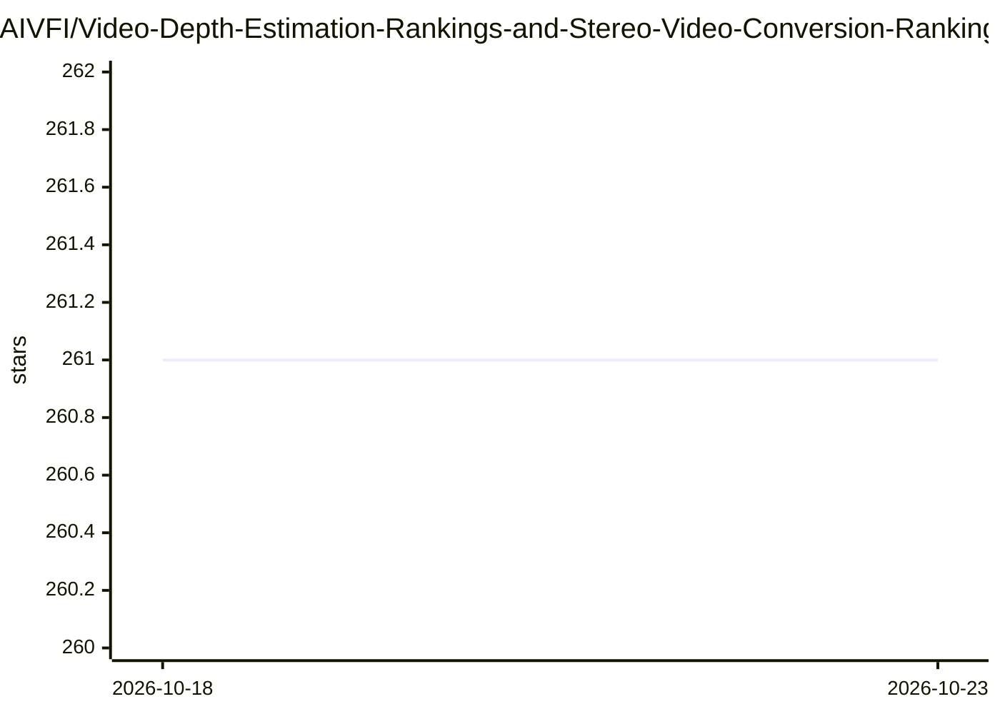

# AIVFI/Video-Depth-Estimation-Rankings-and-Stereo-Video-Conversion-Rankings

⭐ 261 · 推送 2026-10-12 · [GitHub](https://github.com/AIVFI/Video-Depth-Estimation-Rankings-and-Stereo-Video-Conversion-Rankings) · 个人维护

**视频深度估计与立体视频转换的模型排名与数据集策展仓库**

面向计算机视觉研究者的排名与资源策展仓库：收录 2025 年 4 月至 2026 年 10 月的 11 种立体视频转换方法（含 backbone、arXiv 日期、发表会议与代码链接），并整理 54 个合成 RGB-D 视频数据集及 2 个图像数据集，标注分辨率、训练/测试用途与质量警示（2 个标为不建议使用、2 个需谨慎检查），附 T/E 使用统计与论文清单附录。维护者声明部分附录与排名规则尚为待办。README 中另呼吁基于 MiniMax H3 开发新模型。

## 筛选速览

| 维度 | 判定 | 备注 |
|---|---|---|
| AI 角色 | `ai-knowledge` | 知识聚合/清单类 |
| 许可风险 | `none` | — |
| 部署形态 | `None` |  |
| 模型依赖 | — | README 未给出锁定关系 |
| 硬件要求 | — | 无带数字的原话,不猜 |
| 安装摩擦 | `low` | 无编译、无系统依赖或容器化 |
| 成熟度 | `idea` | |

## 能力要点

- 收录 11 种立体视频转换方法的对照表（backbone/venue/代码链接）
- 54 个合成 RGB-D 视频数据集清单，含分辨率与 T/E 训练测试标注
- 对 2 个数据集标注不建议使用、2 个标注需谨慎检查并给出理由指向附录
- 收录相关论文清单（附录 5/6）

## 适用场景

- 查找立体视频转换与视频深度估计领域的最新方法与代码
- 为训练深度估计模型挑选合成 RGB-D 数据集并核对质量警示
- 跟踪各数据集在不同深度模型上的训练/测试使用情况

## 场景标签

`精选清单` · 领域:学习与行业

## 证据(README 行号)

> L30: ## Awesome Stereo Video Conversion
> L59: ## Awesome Synthetic RGB-D Video Datasets for Training and Testing HD Video Depth Estimation Models
> L128: ## 170-frame ScanNet: TAE

## 星数曲线

2026-10-18 261 → 2026-10-23 261（+0）

---
*卡片 v1 · prompt 1.4 · 生成 2026-10-22 · 置信度 high · 依据 README sha `52c78a5709c9` · [字段定义](../../DATASET.md)*
