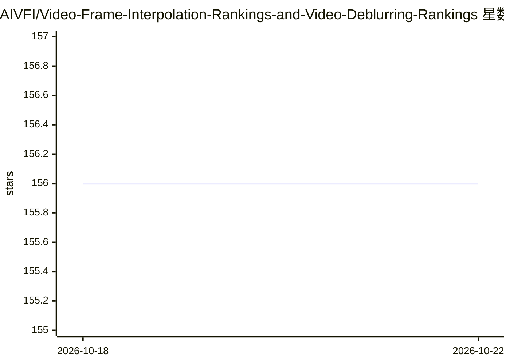

# AIVFI/Video-Frame-Interpolation-Rankings-and-Video-Deblurring-Rankings

⭐ 156 · 推送 2025-11-07 · [GitHub](https://github.com/AIVFI/Video-Frame-Interpolation-Rankings-and-Video-Deblurring-Rankings) · 个人维护

**视频帧插值与去模糊模型评测榜单，面向研究者**

个人维护的视频帧插值（VFI）与视频去模糊模型性能排名清单：按 SNU-FILM、X-TEST、Vimeo-90K、RBI 等测试集组织多个排行榜，以 LPIPS/PSNR 为指标列出各模型（如 HFD、UGFI、BiM-VFI、DvP+ 等）的成绩、发表会议与代码仓库链接；每个排名仅收录一种方法的最佳模型，排除事件驱动与脉冲引导模型。README 附运行时间、入选规则、指标选择与论文列表等附录，并呼吁研究者开发联合去模糊与帧插值模型、使用 Style loss 训练。无安装或代码，为纯内容型榜单。

## 筛选速览

| 维度 | 判定 | 备注 |
|---|---|---|
| AI 角色 | `ai-knowledge` | 知识聚合/清单类 |
| 许可风险 | `none` | — |
| 部署形态 | `None` |  |
| 模型依赖 | — | README 未给出锁定关系 |
| 硬件要求 | — | 无带数字的原话,不猜 |
| 安装摩擦 | `low` | 无编译、无系统依赖或容器化 |
| 成熟度 | — | 结构信号不足 |

## 能力要点

- 覆盖 5 个持续更新的帧插值排行（X-TEST、SNU-FILM-arb 系列、SNU-FILM Extreme）
- 6 个旧版排行（Vimeo-90K、SNU-FILM Hard/Medium 等）已标注停更
- 排除事件驱动与脉冲引导模型，每方法仅取最佳模型
- 附录含运行时间对比、入选规则、指标选择与论文列表

## 适用场景

- 查找当前各测试集上指标领先的帧插值模型及其代码仓库
- 为联合视频去模糊与帧插值研究寻找基线与选型参考
- 了解 Style loss（Gram matrix loss）在各模型中的使用情况

## 场景标签

`精选清单` · 领域:学习与行业

## 证据(README 行号)

> L18: ## List of Rankings
> L22: ### Joint Video Deblurring and Frame Interpolation Rankings

## 星数曲线

2026-10-18 156 → 2026-10-22 156（+0）

---
*卡片 v1 · prompt 1.4 · 生成 2026-10-22 · 置信度 high · 依据 README sha `ef4afcb627b4` · [字段定义](../../DATASET.md)*
