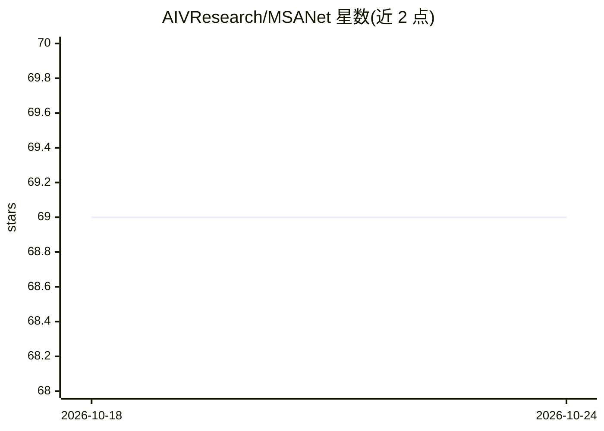

# AIVResearch/MSANet

⭐ 69 · Python · 推送 2026-06-09 · [GitHub](https://github.com/AIVResearch/MSANet) · [官网](https://arxiv.org/abs/2206.09667v1) · 组织维护

**少样本图像分割模型 MSANet 的官方 PyTorch 实现**

论文 Few-Shot Segmentation using Multi-Similarity and Attention Guidance 的官方 PyTorch 代码：提出多相似性模块与注意力模块，利用 support/query 图像的多个特征图估计语义关系，在 PASCAL-5i 与 COCO-20i 的 1-shot/5-shot 基准上评测。提供 VGG16/ResNet50/ResNet101 预训练骨干与训练好的模型下载，需自行准备 PASCAL、COCO、SBD 数据集与 BAM 基础标注，通过修改 yaml 配置并运行 test.py 进行测试。代码基于 PFENet、HSNet、BAM 构建。

## 筛选速览

| 维度 | 判定 | 备注 |
|---|---|---|
| AI 角色 | `ai-native` | 本体是模型或模型工具 |
| 许可风险 | `none` | — |
| 部署形态 | `None` |  |
| 模型依赖 | — | README 未给出锁定关系 |
| 硬件要求 | — | 无带数字的原话,不猜 |
| 安装摩擦 | `medium` | 含编译或系统依赖之一 |
| 成熟度 | — | 结构信号不足 |

## 能力要点

- 多相似性模块利用 support 与 query 的多个特征图估计语义关系
- 注意力模块引导网络关注类相关信息
- 提供 VGG16/ResNet50 骨干在 PASCAL-5i 与 COCO-20i 的 1/5-shot 训练模型
- 代码基于 PFENet、HSNet、BAM 构建

## 适用场景

- 复现论文中少样本分割实验结果
- 在 PASCAL-5i/COCO-20i 基准上做性能评测
- 作为少样本分割研究的代码基础进行改进

## 场景标签

`目标检测` `模型评测` · 领域:评测与运维

## 证据(README 行号)

> L3: This is the official implementation of the paper Few-Shot Segmentation using Multi-Similarity and Attention Guidance
> L7: > **Abstract:** *Few-shot segmentation (FSS) methods aim to segment objects of novel classes with relatively few ann

## 星数曲线

2026-10-18 69 → 2026-10-24 69（+0）

---
*卡片 v1 · prompt 1.4 · 生成 2026-10-24 · 置信度 high · 依据 README sha `f4a4dcf2097a` · [字段定义](../../DATASET.md)*
