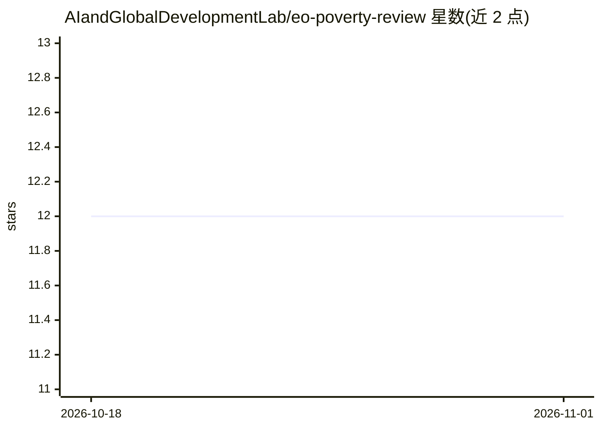

# AIandGlobalDevelopmentLab/eo-poverty-review

⭐ 12 · TeX · 推送 2026-01-18 · [GitHub](https://github.com/AIandGlobalDevelopmentLab/eo-poverty-review) · [官网](https://arxiv.org/abs/2406.02584) · 组织维护

**地球观测×机器学习×因果推断论文清单：面向贫困与发展研究**

由 AI and Global Development Lab 维护的论文目录，收录连接机器学习与因果推断的地球观测研究，覆盖气候、发展与贫困领域。由 Kaz Sakamoto 为范围综述编制，与 Adel Daoud、Connor T. Jerzak 合作，社区可通过 issue 补充条目。条目按作者-年份-标题-DOI/arXiv 链接的文献格式组织，关联 .bib 引用条目存于 citations 目录。仓库本身不含代码或可运行组件，定位为文献参考目录。

## 筛选速览

| 维度 | 判定 | 备注 |
|---|---|---|
| AI 角色 | `ai-knowledge` | 知识聚合/清单类 |
| 许可风险 | `none` | — |
| 部署形态 | `None` |  |
| 模型依赖 | — | README 未给出锁定关系 |
| 硬件要求 | — | 无带数字的原话,不猜 |
| 安装摩擦 | `low` | 无编译、无系统依赖或容器化 |
| 成熟度 | — | 结构信号不足 |

## 能力要点

- 收录 EO×ML×因果推断交叉领域的论文条目
- 每条提供 DOI 或 arXiv 链接，关联 .bib 文件
- 社区可通过 issue 提交新论文

## 适用场景

- 为地球观测与因果推断交叉研究做文献调研
- 查找贫困与气候方向使用遥感与 ML 的因果研究
- 获取综述可引用的 .bib 条目

## 场景标签

`科研工具` `精选清单` · 领域:学习与行业

## 证据(README 行号)

> L1: # Awesome Papers on Earth Observation (EO) in Machine Learning (ML) and Causal Inference (CI)
> L5: This repo is a curated on-ramp to that frontier: a growing, community-updated directory of papers that connect moder

## 星数曲线

2026-10-18 12 → 2026-11-01 12（+0）

---
*卡片 v1 · prompt 1.4 · 生成 2026-11-01 · 置信度 high · 依据 README sha `de238c4d432a` · [字段定义](../../DATASET.md)*
