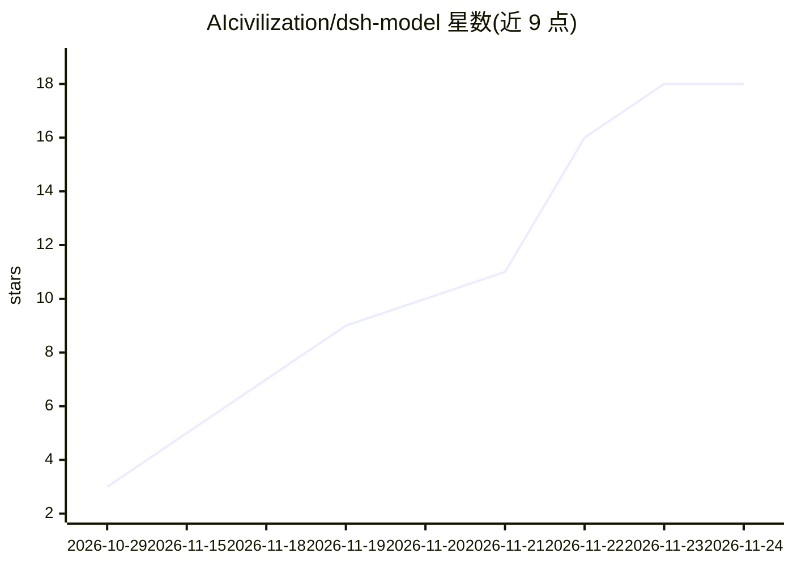

# AIcivilization/dsh-model

⭐ 18 · TypeScript · MIT · 推送 2026-11-22 · [GitHub](https://github.com/AIcivilization/dsh-model) · [官网](https://www.npmjs.com/package/dsh-model) · 个人维护 · 中文 README

**个人用户的 LLM 中转网关插件：自动签到领积分并聚合多来源模型**

dsh 的插件兼 npm 工具，基于 CLIProxyAPI 引擎在本机 127.0.0.1:8317/v1 运行 OpenAI 兼容地址。功能：11 家产品的每日自动签到（多账号、VPS 补签）、把分散在十余平台的免费额度合成 free/auto 等三个模型、订阅与按量付费来源统一中转，支持组合切换与自动切换降级。MIT 许可，不含自有服务器与遥测；README 提示订阅凭据在官方客户端外使用有账号风险。需 Node ≥ 20，支持 Windows/macOS/Linux。

## 筛选速览

| 维度 | 判定 | 备注 |
|---|---|---|
| AI 角色 | `ai-ecosystem` | LLM/agent 周边工具 |
| 许可风险 | `permissive` | MIT |
| 部署形态 | `library` | 以包/库形式分发 |
| 模型依赖 | local-ok | 支持本地模型 |
| 硬件要求 | — | 无带数字的原话,不猜 |
| 安装摩擦 | `low` | 无编译、无系统依赖或容器化 |
| 成熟度 | — | 结构信号不足 |

## 能力要点

- 11 家产品每日自动签到，支持多账号与 VPS 导入补签
- 免费池一把 key 聚合各家官方免费额度，按过期顺序调度
- 一个 OpenAI 兼容地址中转 36+ 模型来源，支持组合/自动切换
- 本机 Ollama、LM Studio 启动后自动出现，无需登录

## 适用场景

- 自动领取 Trae、Qoder 等产品的每日签到积分
- 把免费额度聚合后供编辑器和脚本统一调用
- 一个来源限流或额度用完时自动切换到下一个模型

## 场景标签

`模型网关` · 领域:Agent 开发

## 证据(README 行号)

> L77: 你手上的模型来源，各家接口、登录方式都不一样。dsh-model 把它们合成**一个 OpenAI 兼容地址**：
> L98: 每个来源都标出「免费 / 免费·额度少 / 需付费」，详见下面的来源与费用。dsh-model 只负责转接，不提供额度。
> L214: - 引擎是 CLIProxyAPI（MIT），版本锁定并校验 sha256。WorkBuddy 协议层移植自 dsh-workbuddy-connect（MIT），订阅用量的查询接口参考了 CodexBar（MIT）。

## 星数曲线

2026-10-29 3 → 2026-11-24 18（+15）

---
*卡片 v1 · prompt 1.4 · 生成 2026-11-20 · 置信度 high · 依据 README sha `6d4e7b4671d0` · [字段定义](../../DATASET.md)*
