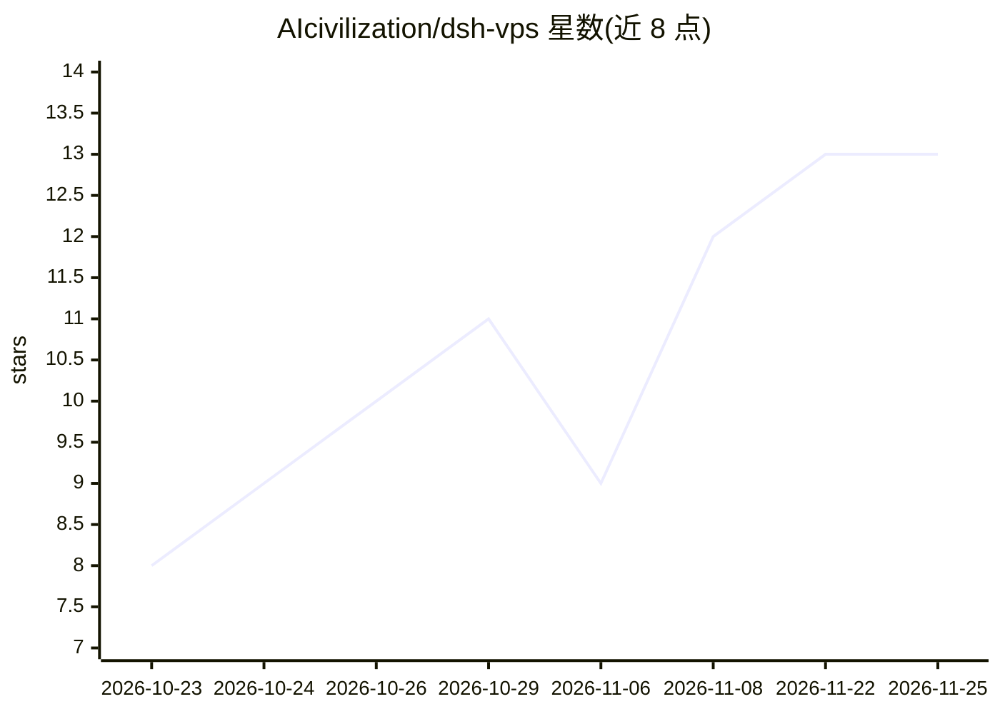

# AIcivilization/dsh-vps

⭐ 13 · JavaScript · MIT · 推送 2026-11-22 · [GitHub](https://github.com/AIcivilization/dsh-vps) · [官网](https://aicivilization.github.io/dsh-vps/) · 个人维护 · 中文 README

**给开发者一键部署 DeepSeek Harness 到 VPS 的部署工具**

dsh-vps 是 DeepSeek Harness（DSH）的 VPS 部署工具，解决 DSH 特权接口（设置、API Key、插件管理）只信任本机浏览器、直接反代到公网即失效的问题。它以零运行时依赖的登录网关 dsh-gate 架在 DSH 前：公网请求先过 scrypt 登录门，网关再以服务端身份完成会话认证并透传。支持 DSH 内填表安装或 curl|bash 一键脚本，带 Caddy 自动 HTTPS、systemd 托管、备份回滚式升级、卸载与运维命令。要求 Ubuntu 22.04+/Debian 12+、2C2G 以上、80/443 端口开放。

## 筛选速览

| 维度 | 判定 | 备注 |
|---|---|---|
| AI 角色 | `ai-ecosystem` | LLM/agent 周边工具 |
| 许可风险 | `permissive` | MIT |
| 部署形态 | `library` | 以包/库形式分发 |
| 模型依赖 | locked-api |  |
| 硬件要求 | — | 无带数字的原话,不猜 |
| 安装摩擦 | `low` | 无编译、无系统依赖或容器化 |
| 成熟度 | — | 结构信号不足 |

## 能力要点

- 零运行时依赖登录网关：scrypt 口令 + HMAC 会话 Cookie + 登录限流
- 两种装法：DSH 插件市场填表安装，或 VPS 上一条 curl|bash 命令
- Caddy 自动 HTTPS 与域名热加载；升级走备份→自检→失败自动回滚
- 预置 3 款插件：VPS 部署设置页、插件选购顾问 dsh-pick、VPS 管理

## 适用场景

- 把自己的 DeepSeek Harness 部署到 VPS，从任意浏览器访问原版界面
- 公网域名下继续使用设置页、API Key 与插件市场
- 手机扫码添加到主屏幕，像应用一样全屏使用 DSH

## 场景标签

 · 领域:开发运维/部署工具

## 证据(README 行号)

> L20: > **这是 DSH 的 VPS 部署工具：把带登录界面的原版 DSH 装到你自己的 VPS 上，之后在任何地方用浏览器访问。** 两种装法任选其一：
> L34: DeepSeek Harness（DSH）默认只认本机浏览器：它的特权接口（设置、API Key、插件管理）受浏览器信任围栏保护，直接反代到公网后这些页面全部失效。
> L36: dsh-vps 用一个零运行时依赖的登录网关（dsh-gate）架在 DSH 前面：公网请求先过 scrypt 登录门，再由网关以服务端身份完成 DSH 会话认证并透传。你在任何地方打开浏览器，用的都是官方原版的 DSH Web 

## 星数曲线

2026-10-23 8 → 2026-11-25 13（+5）

---
*卡片 v1 · prompt 1.4 · 生成 2026-11-18 · 置信度 high · 依据 README sha `c62ca85fd331` · [字段定义](../../DATASET.md)*
