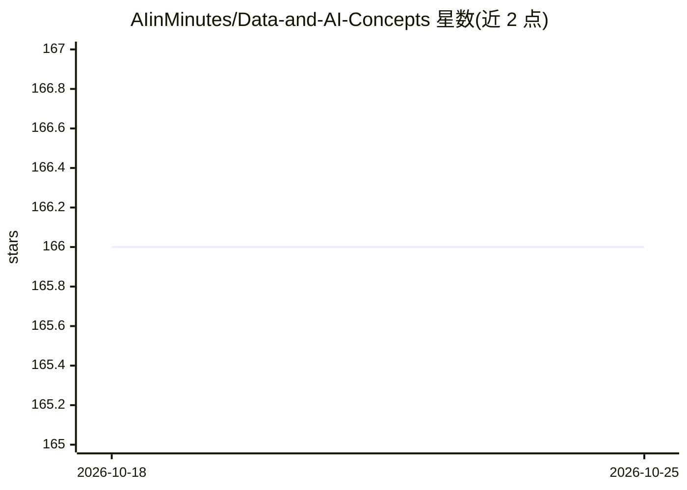

# AIinMinutes/Data-and-AI-Concepts

⭐ 166 · Python · NOASSERTION · 推送 2026-09-12 · [GitHub](https://github.com/AIinMinutes/Data-and-AI-Concepts) · [官网](https://www.threads.net/@aiinminutes) · 个人维护

**数据/统计/AI 概念的可运行笔记本笔记集（源自高引论文）**

个人维护的策展式知识库：将数据、统计与 AI 概念整理为短小可运行的 Marimo 笔记本，每个条目包含概念、数学推导和一个小实验，内容取自高引用研究论文。笔记分为 fundamentals（统计、ML、深度学习、生成式 AI 基础）与论文专题（首个为 TabICLv2 表格基础模型）。依赖用 uv 管理，要求 Python 3.10–3.12，笔记发布于 learnaiinminutes.com。代码以 MIT 许可。

## 筛选速览

| 维度 | 判定 | 备注 |
|---|---|---|
| AI 角色 | `ai-knowledge` | 知识聚合/清单类 |
| 许可风险 | `none` | NOASSERTION |
| 部署形态 | `library` | 以包/库形式分发 |
| 模型依赖 | — | README 未给出锁定关系 |
| 硬件要求 | — | 无带数字的原话,不猜 |
| 安装摩擦 | `medium` | 含编译或系统依赖之一 |
| 成熟度 | `idea` | |

## 能力要点

- 概念+数学+小实验的短篇 Marimo 笔记本
- 内容源自高引用研究论文
- uv 管理依赖，单命令启动交互式编辑
- 论文专题从 TabICLv2 表格基础模型开始

## 适用场景

- 通过可运行笔记本学习统计与 AI 概念
- 查找高引论文对应的概念讲解与实验
- 跟随 TabICLv2 论文复现工作

## 场景标签

`教程课程` · 领域:学习与行业

## 证据(README 行号)

> L3: This repository is a curated collection of data, stats, and AI concepts drawn from highly cited research papers. Eac
> L33: Notes that are **not** tied to a specific paper live in `notebooks/fundamentals/`. They cover stats, ML, deep learn

## 星数曲线

2026-10-18 166 → 2026-10-25 166（+0）

---
*卡片 v1 · prompt 1.4 · 生成 2026-10-22 · 置信度 mid · 依据 README sha `f69b9b9b9534` · [字段定义](../../DATASET.md)*
