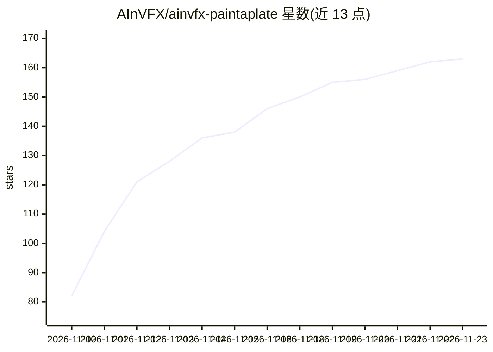

# AInVFX/ainvfx-paintaplate

⭐ 163 · Python · Apache-2.0 · 推送 2026-11-22 · [GitHub](https://github.com/AInVFX/ainvfx-paintaplate) · [官网](www.ainvfx.com/open-source/) · 组织维护

**给视效合成师的 ComfyUI 节点包：首帧涂绘擦除/添加/重光并贯穿整镜头**

面向 VFX 合成流程的 ComfyUI 节点包及自带前端页面：在镜头首帧上涂绘即可擦除、添加物体或重新打光，编辑结果自动贯穿整个镜头；空白板上可绘制并生成烟、火、水等流体（自研 ainvfx-fluid IC-LoRA）。组合 FLUX 3 Image Klein（首帧编辑）、LTX 2.5（镜头延续）、SAM 3.1（物体分割跟踪）等开放权重模型，通过 OpenColorIO 按原始画质审看，导出保持原 plate 的格式、位深、时间码与 EXR 层。需要约 60 GB 模型与大型 NVIDIA GPU（推荐 32 GB+ VRAM），也支持 Runpod 部署。

## 筛选速览

| 维度 | 判定 | 备注 |
|---|---|---|
| AI 角色 | `ai-native` | 本体是模型或模型工具 |
| 许可风险 | `permissive` | Apache-2.0 |
| 部署形态 | `desktop` | 安装包/桌面程序 |
| 模型依赖 | — | README 未给出锁定关系 |
| 硬件要求 | — | 无带数字的原话,不猜 |
| 安装摩擦 | `medium` | 含编译或系统依赖之一 |
| 成熟度 | — | 结构信号不足 |

## 能力要点

- 首帧涂绘编辑（擦除/添加/重光）自动贯穿整镜头
- 自研 ainvfx-fluid IC-LoRA 将涂绘关键帧转为烟/火/蒸汽/爆炸等流体
- 导出保持 plate 原有格式、位深、时间码、音频与 EXR 层，未触及像素保持一致
- 通过 OpenColorIO 以 EXR 原精度审看，可导出完整 ComfyUI 工作流

## 适用场景

- 在实拍镜头中擦除不需要的物体或角色
- 为镜头添加或重新打光元素（灯、火、日落）
- 在空白板上生成烟、火、雾等流体特效
- 按原有画质与格式审看并导出合成结果

## 场景标签

`图像生成` `图像视频处理` · 领域:内容生成

## 证据(README 行号)

> L17: Paint a plate is a ComfyUI node pack with its own page. Every step is a ComfyUI workflow from `web/workflows`, open
> L19: - **FLUX 3 Image Klein** edits the first frame. Its own prompt upsampler, a Qwen 3.5 9B model from Black Forest Lab
> L20: - **LTX 2.5** carries the edit through the shot. Lightricks' in-outpainting IC-LoRA regenerates erased areas; WepeN

## 星数曲线

2026-11-10 82 → 2026-11-23 163（+81）

---
*卡片 v1 · prompt 1.4 · 生成 2026-11-17 · 置信度 high · 依据 README sha `999db65e7236` · [字段定义](../../DATASET.md)*
