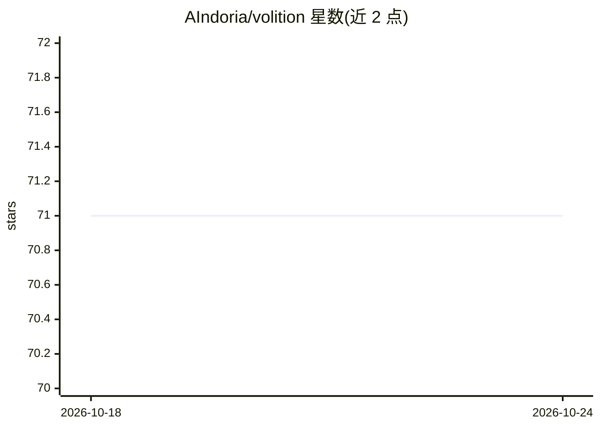

# AIndoria/volition

⭐ 71 · Python · NOASSERTION · 推送 2026-07-11 · [GitHub](https://github.com/AIndoria/volition) · 个人维护

**自托管多 agent 系统：在 Proxmox LXC 中运行持久自克隆的 LLM agent 管理家庭实验室**

面向家庭实验室（homelab）运维者的自托管多 agent 系统：将称为 Abe 的持久 LLM agent 部署在隔离的 Proxmox LXC 容器中，每个 Abe 具备三层可溯源长期记忆（日志/摘要/RAG）、可推理、行动并生成子 agent，通过 Redis 通信，受人类定义的 SSH/sudo 控制边界约束。架构含 GPU Worker（嵌入与摘要）、Ear（上下文恢复）、Logger 与 Heartbeat。推理默认经 OpenRouter，本地任务可用 Ollama。强制要求 Proxmox VE、Redis、Python 3.10+ 与 OpenRouter API key；处于 Public Alpha，作者声明需授予 agent 免密 SSH+sudo，误配置存在风险，且需通读 docs/ 方可运行。

## 筛选速览

| 维度 | 判定 | 备注 |
|---|---|---|
| AI 角色 | `ai-ecosystem` | LLM/agent 周边工具 |
| 许可风险 | `none` | NOASSERTION |
| 部署形态 | `None` |  |
| 模型依赖 | local-ok | 支持本地模型 |
| 硬件要求 | — | 无带数字的原话,不猜 |
| 安装摩擦 | `low` | 无编译、无系统依赖或容器化 |
| 成熟度 | `idea` | |

## 能力要点

- Agent 运行于隔离 Proxmox LXC 容器，持久化且可生成子 agent
- 三层可溯源长期记忆：日志→摘要→RAG 嵌入闭环
- Genesis 引导脚本强制人类声明控制边界（SSH 白名单、sudo 规则）
- 推理支持 OpenRouter 或任意 OpenAI 兼容端点（如 Ollama/llama.cpp）

## 适用场景

- 让持久 agent 协助管理家庭实验室的服务器与服务
- 运维场景中多 agent 互相协作、排查故障并自愈（受限边界内）
- 需要全程可审计（Logger 不可变日志）的自治 agent 实验

## 场景标签

`多智能体` `Agent 记忆` · 领域:Agent 开发

## 证据(README 行号)

> L9: Volition (fondly referred to me as the Abiverse) is a self-hosted, multi-agent system designed to run persistent, se
> L56: * **Abe Containers (LXC)** – cognitive agents (GUPPI, memory, reasoning)
> L74:  * As of 8.0 (Public 0.8) guppi.py uses either Openrouter or any OpenAI compatible endpoing (eg llama.cpp/ollama et

## 星数曲线

2026-10-18 71 → 2026-10-24 71（+0）

---
*卡片 v1 · prompt 1.4 · 生成 2026-10-24 · 置信度 high · 依据 README sha `27c2db57c28c` · [字段定义](../../DATASET.md)*
