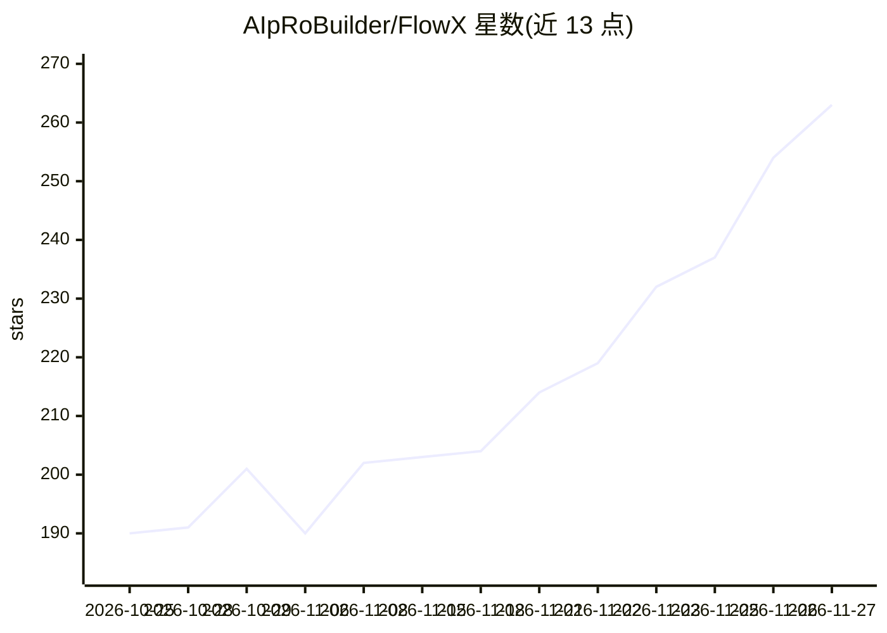

# AIpRoBuilder/FlowX

⭐ 263 · Python · Apache-2.0 · 推送 2026-11-26 · [GitHub](https://github.com/AIpRoBuilder/FlowX) · [官网](https://www.flow-x.work) · 组织维护 · 中文 README

**让编码 agent 生成、审计并运行 AI 工作流的 MCP 服务器与 SDK**

FlowX 通过 MCP、Python SDK 或 A2A 三个接口，让外部编码 agent 按合同生成、审计、测试并运行工作流：每个构建步骤返回包含契约与工件槽位的 packet，宿主 agent 编写代码，FlowX 用审计器与 pytest 校验，未通过节点不予发布并返回修复建议。本体不调用模型、无需 API key，可发布版本化节点并渲染 FastAPI 后端。要求 Python 3.10+ 与 MCP 宿主 agent；生成的代码与测试不在沙箱中运行。

## 筛选速览

| 维度 | 判定 | 备注 |
|---|---|---|
| AI 角色 | `ai-ecosystem` | LLM/agent 周边工具 |
| 许可风险 | `permissive` | Apache-2.0 |
| 部署形态 | `library` | 以包/库形式分发 |
| 模型依赖 | — | README 未给出锁定关系 |
| 硬件要求 | — | 无带数字的原话,不猜 |
| 安装摩擦 | `medium` | 含编译或系统依赖之一 |
| 成熟度 | — | 结构信号不足 |

## 能力要点

- 每个构建步骤返回合同 packet，由宿主编码 agent 编写工件
- 审计与 pytest 校验每节点，失败节点返回结构化修复建议
- 支持整体或单节点演化，复用未变更输入的节点
- 本地 stdio MCP、Python SDK、非流式 A2A 三种接口

## 适用场景

- 把自然语言意图转为可编辑、可复用、可版本化的工作流
- 让编码 agent 构建并运行多节点图片/视频生成流程
- 对已生成工作流做单节点修补而无需重建全流程

## 场景标签

`工作流自动化` · 领域:效率与自动化

## 证据(README 行号)

> L27: FlowX lets AI agents **build, run, and evolve workflows** through MCP, a Python SDK, or A2A. FlowX does not call a 
> L37: - **[2026.11.22]** 🧭 **Agent-driven builds; no LLM inside FlowX.** FlowX is now two things: a **workflow builder** 
> L133: FlowX needs no model key. Provider and media variables (for example `FLOWX_IMAGE_API_KEY`) are only for the workfl

## 星数曲线

2026-10-25 190 → 2026-11-27 263（+73）

---
*卡片 v1 · prompt 1.4 · 生成 2026-11-27 · 置信度 high · 依据 README sha `17afbd1a1227` · [字段定义](../../DATASET.md)*
