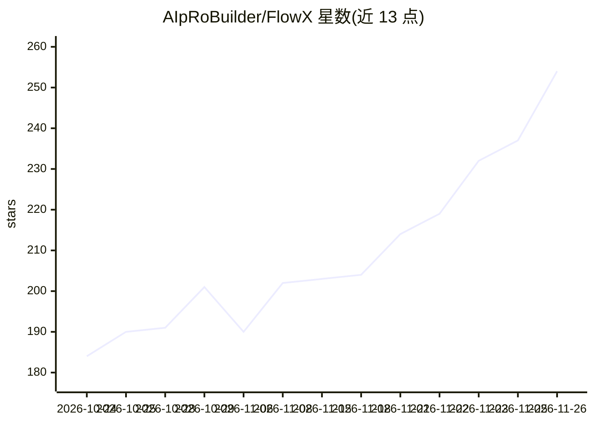

# AIpRoBuilder/FlowX

⭐ 254 · Python · Apache-2.0 · 推送 2026-11-25 · [GitHub](https://github.com/AIpRoBuilder/FlowX) · [官网](https://www.flow-x.work) · 组织维护

**让 coding agent 构建、审计并运行 AI 工作流的 MCP server 与 SDK**

FlowX 通过 MCP、Python SDK 或 A2A 三种接口让外部 coding agent 构建工作流：每个构建步骤返回包含契约、规则与工件的 packet，由宿主 agent 编写代码；FlowX 负责审计、运行 pytest、发布版本化节点并渲染 FastAPI 后端运行。自身不调用模型、无需模型 API key。节点可输出 prompt/图像/视频卡片，提供媒体处理工具链（Pillow/FFmpeg/可选 Blender）。生成代码与测试不在沙箱中运行，provider 调用可能计费。安装方式为 git clone 后 pip/Poetry/uv 安装。

## 筛选速览

| 维度 | 判定 | 备注 |
|---|---|---|
| AI 角色 | `ai-ecosystem` | LLM/agent 周边工具 |
| 许可风险 | `permissive` | Apache-2.0 |
| 部署形态 | `library` | 以包/库形式分发 |
| 模型依赖 | — | README 未给出锁定关系 |
| 硬件要求 | — | 无带数字的原话,不猜 |
| 安装摩擦 | `medium` | 含编译或系统依赖之一 |
| 成熟度 | — | 结构信号不足 |

## 能力要点

- 本地 stdio MCP server、Python SDK、非流式 A2A 三种接口
- 契约驱动的节点级审计与 pytest 测试，未通过节点不予发布
- 支持整工作流或单节点的演进（evolve），复用未变更节点
- 生成节点可返回 prompt/图像/视频卡片

## 适用场景

- 用自然语言描述意图，让 agent 生成可编辑、可复用的工作流
- 为生成的智能体工作流渲染 FastAPI 后端并本地运行
- 修改单个节点时复用其余未变更的节点

## 场景标签

`工作流自动化` · 领域:效率与自动化

## 证据(README 行号)

> L27: FlowX lets AI agents **build, run, and evolve workflows** through MCP, a Python SDK, or A2A. FlowX does not call a 
> L37: - **[2026.11.22]** 🧭 **Agent-driven builds; no LLM inside FlowX.** FlowX is now two things: a **workflow builder** 
> L63: - 🔌 **Choose an interface:** local stdio MCP, Python SDK, or non-streaming A2A (a build is an `input-required` task

## 星数曲线

2026-10-24 184 → 2026-11-26 254（+70）

---
*卡片 v1 · prompt 1.4 · 生成 2026-11-25 · 置信度 high · 依据 README sha `e7ca7cdfb343` · [字段定义](../../DATASET.md)*
