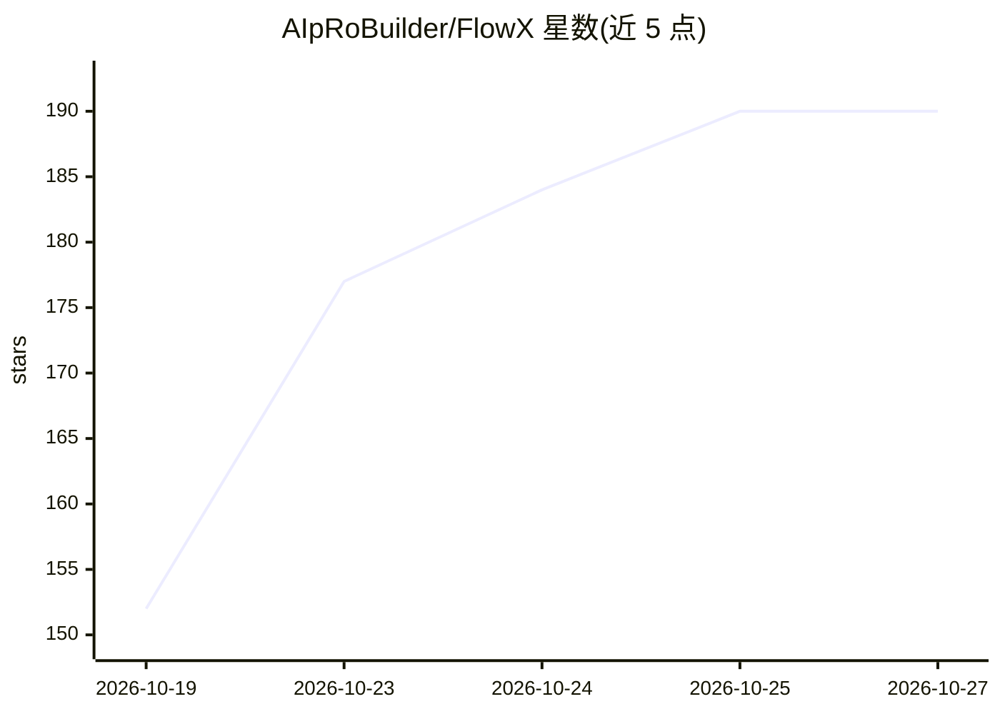

# AIpRoBuilder/FlowX

⭐ 190 · Python · Apache-2.0 · 推送 2026-10-24 · [GitHub](https://github.com/AIpRoBuilder/FlowX) · [官网](https://aiprobuilder.github.io/flowx_web/) · 组织维护

**让 AI agent 用自然语言生成并运行工作流的 MCP 服务器与 Python SDK**

FlowX 是一个开源 Generative Workflow 层：MCP 服务器、Python SDK 与 A2A 适配器共享同一核心，让 AI agent 将自然语言意图转换为 workflow.json 图结构、节点 Python 代码与可运行的 FastAPI 后端，并在同一对话中检查、运行、修改该工作流，产物持久化在 workspace/workflows 下可复用。主要交互路径为本地 stdio MCP，A2A 端点目前为非流式构建。需要 Python 3.10+，通过 LLM provider/model/API key 环境变量配置生成所用模型。

## 筛选速览

| 维度 | 判定 | 备注 |
|---|---|---|
| AI 角色 | `ai-ecosystem` | LLM/agent 周边工具 |
| 许可风险 | `permissive` | Apache-2.0 |
| 部署形态 | `library` | 以包/库形式分发 |
| 模型依赖 | — | README 未给出锁定关系 |
| 硬件要求 | — | 无带数字的原话,不猜 |
| 安装摩擦 | `low` | 无编译、无系统依赖或容器化 |
| 成熟度 | — | 结构信号不足 |

## 能力要点

- 意图 → 工作流图 → 节点代码 → FastAPI 后端的生成流水线
- 对话式细化：后续修改只重建受影响节点，未变节点复用
- MCP（stdio/FastMCP）、Python SDK、A2A（message/send 等 JSON-RPC）三种接入方式
- 工作流产物落盘持久化，可列出节点、按 step id 定向修改

## 适用场景

- 在 MCP 客户端对话中让 agent 构建并运行工单分类、分派、草拟回复等流程
- 通过 Python SDK 在自有应用后端嵌入工作流生成与执行能力
- 让另一个 agent 通过 A2A 端点委托 FlowX 生成工作流

## 场景标签

`工作流自动化` · 领域:效率与自动化

## 证据(README 行号)

> L19: FlowX is an **MCP server and Python SDK that lets AI agents build workflows**. Describe a process in plain language
> L62: |**FlowX: Generative Workflow**|Turn intent into workflow artifacts; expose tools to inspect, execute, and refine t
> L239: The Generative Workflow layer has one shared core and three agent-facing interfaces: `flowx_core` plans, generates

## 星数曲线

2026-10-19 152 → 2026-10-27 190（+38）

---
*卡片 v1 · prompt 1.4 · 生成 2026-10-23 · 置信度 high · 依据 README sha `70652fc8741f` · [字段定义](../../DATASET.md)*
