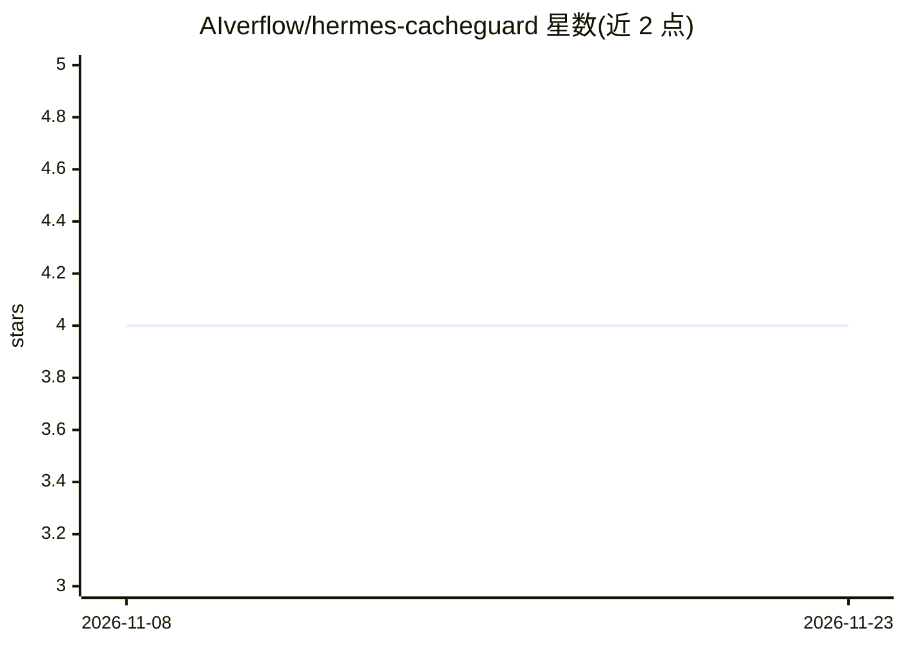

# AIverflow/hermes-cacheguard

⭐ 4 · Python · MIT · 推送 2026-11-07 · [GitHub](https://github.com/AIverflow/hermes-cacheguard) · 个人维护

**Hermes 插件：防止向过期缓存浪费 LLM 调用费用**

面向 Hermes 用户的提示缓存成本控制插件：在暂停后消息可能因缓存失效被按全价计费，插件据此提供 block（发送前拦截）与 warn（事后报告）两种模式，从用户自身使用记录学习相似暂停后的缓存丢失频率，并提供 /cacheguard 表格按暂停长度统计。支持按 CLI/桌面/Web/网关分组与按模型单独设置；以本地读取 Hermes 传入数据的方式运行，无网络调用与消息文本存储。要求 Hermes 0.22.6 或更新版本。

## 筛选速览

| 维度 | 判定 | 备注 |
|---|---|---|
| AI 角色 | `ai-ecosystem` | LLM/agent 周边工具 |
| 许可风险 | `permissive` | MIT |
| 部署形态 | `None` |  |
| 模型依赖 | — | README 未给出锁定关系 |
| 硬件要求 | — | 无带数字的原话,不猜 |
| 安装摩擦 | `low` | 无编译、无系统依赖或容器化 |
| 成熟度 | — | 结构信号不足 |

## 能力要点

- block 模式在发送前拦截可能被全额计费的消息，支持 /retry 发送
- 按暂停长度统计历史缓存丢失频率并展示在 /cacheguard 表格
- 按 cli/desktop/gateway 分组与按模型独立配置模式、暂停与大小阈值
- 无网络、无子进程、不调用模型，不存储消息文本

## 适用场景

- 大型长对话中途暂停后返回，避免缓存失效导致全额计费
- 通过 Telegram 网关使用 Hermes 时控制缓存成本
- 在 Telegram 等消息平台（网关）中使用 Hermes 时控制缓存成本
- 了解自己各提供商模型在不同暂停时长下的缓存丢失情况

## 场景标签

`LLM 可观测性` · 领域:评测与运维

## 证据(README 行号)

> L3: A Hermes plugin that stops you wasting money on an expired cache.
> L8: cacheguard can stop it before it is sent (`block`) or tell you afterwards what was reused or rebilled (`warn`).
> L26: Needs Hermes 0.22.6 or newer.

## 星数曲线

2026-11-08 4 → 2026-11-23 4（+0）

---
*卡片 v1 · prompt 1.4 · 生成 2026-11-21 · 置信度 high · 依据 README sha `b35e7cbfcd4d` · [字段定义](../../DATASET.md)*
