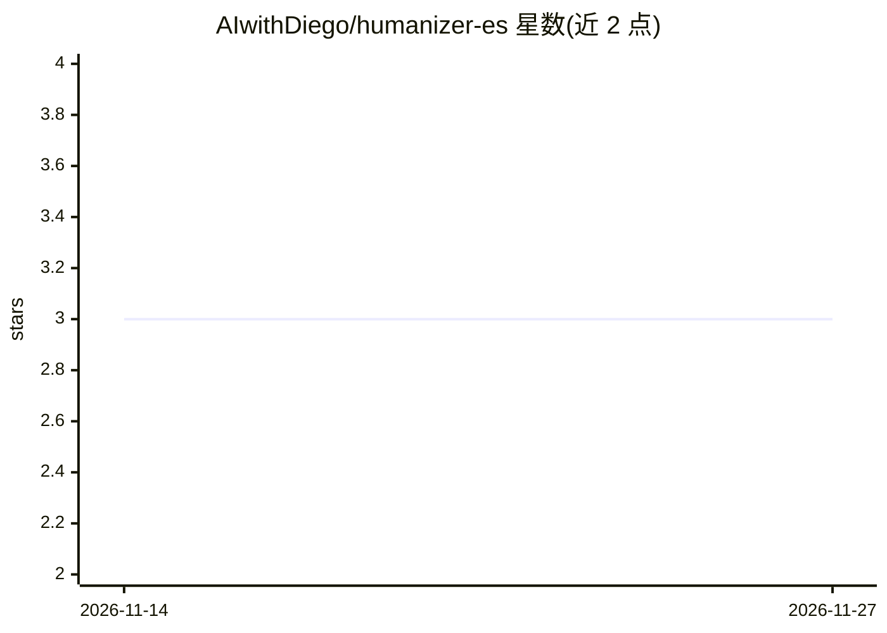

# AIwithDiego/humanizer-es

⭐ 3 · Python · MIT · 推送 2026-11-09 · [GitHub](https://github.com/AIwithDiego/humanizer-es) · [官网](https://www.aiwithdiego.com/recursos/slop) · 个人维护

**让 AI 生成的西班牙语文本更像人写且不改事实的工具包**

面向用西班牙语写作的工作者（从智利与拉美小企业主起步）的去 AI 痕迹工具包，包含三部分：Claude Code 技能（按强度分级的西语 AI 特征清单与四步工作流）、可粘贴到 ChatGPT/Claude.ai 的提示词、以及离线正则检查器 deslop-es（5 分制评分，可在 CI 中以退出码使用）。核心约束为不添加任何事实、仅做删改，并对每处改写做事实审计；附带盲测评估数据与评估记录。

## 筛选速览

| 维度 | 判定 | 备注 |
|---|---|---|
| AI 角色 | `ai-native` | 本体是模型或模型工具 |
| 许可风险 | `permissive` | MIT |
| 部署形态 | `None` |  |
| 模型依赖 | — | README 未给出锁定关系 |
| 硬件要求 | — | 无带数字的原话,不猜 |
| 安装摩擦 | `low` | 无编译、无系统依赖或容器化 |
| 成熟度 | — | 结构信号不足 |

## 能力要点

- Claude Code 技能、通用聊天粘贴提示词与离线正则检查器三种形态
- 改写遵循不添加事实的规则，并对每条声明做事实审计
- 检查器 deslop-es 离线运行、5 分制评分、退出码可接入 CI
- 附带盲测评估数据（30 个 brief、双模型评委、锁定测试集）

## 适用场景

- 把 ChatGPT 写的客户邮件或 Instagram 文案改得更像人写
- 在发布前检查西语文本中的 AI 痕迹
- 在 CI 中自动化检测 AI 生成文本

## 场景标签

`AI 写作` · 领域:内容生成

## 证据(README 行号)

> L70: Paste a Spanish text. The skill decides whether a person or an AI wrote it, cuts the AI tells without adding anythi
> L74: |**The skill**|Full workflow for Claude Code: tells ranked by strength, a draft, a self-audit, an optional second p

## 星数曲线

2026-11-14 3 → 2026-11-27 3（+0）

---
*卡片 v1 · prompt 1.4 · 生成 2026-11-22 · 置信度 high · 依据 README sha `6fccf15443e5` · [字段定义](../../DATASET.md)*
