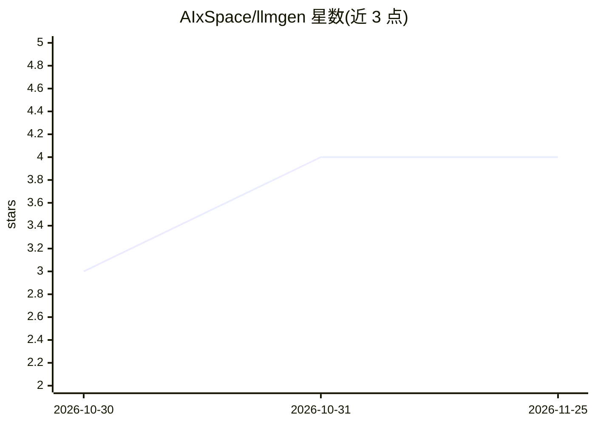

# AIxSpace/llmgen

⭐ 4 · Zig · 推送 2026-10-21 · [GitHub](https://github.com/AIxSpace/llmgen) · 个人维护 · 中文 README

**Zig+CUDA 从零实现的本地 LLM 推理引擎，不依赖 PyTorch**

以约 1.1 万行 Zig 加 2.2 千行 CUDA 从零实现的推理引擎：自带 GGUF 解析、BPE 分词、计算图、调度器、分页 KV Cache 与 CUDA kernel，直接读取 GGUF BF16 权重，提供 CPU 与 CUDA 双后端。服务端机制包括 continuous batching（prefill_first/chunked 两种调度策略与抢占）、CUDA Graph 分桶回放、FA2 prefill、split-K flash-decoding、GPU 采样。运行方式为 make 构建 + 命令行 chat/bench 子命令；README 附带与 nano-vllm 的压测流程与优化教程。

## 筛选速览

| 维度 | 判定 | 备注 |
|---|---|---|
| AI 角色 | `ai-ecosystem` | LLM/agent 周边工具 |
| 许可风险 | `none` | — |
| 部署形态 | `None` |  |
| 模型依赖 | local-ok | 支持本地模型 |
| 硬件要求 | — | 无带数字的原话,不猜 |
| 安装摩擦 | `medium` | 含编译或系统依赖之一 |
| 成熟度 | `idea` | |

## 能力要点

- CPU/CUDA 双后端共用同一套计算图，CPU 版作正确性参考
- continuous batching（prefill_first/chunked 调度与 KV 不足时抢占）
- CUDA Graph 分桶回放、FA2 prefill、split-K flash-decoding、GPU 采样
- greedy 输出带 token ids，支持逐 token 对拍与单元测试

## 适用场景

- 在本地 GPU 上运行 Qwen3 类 GGUF 模型进行对话生成
- 对推理引擎做可复现的吞吐/延迟压测（workload JSON 输出）
- 学习 LLM serving 各阶段（调度、KV、kernel）的优化过程

## 场景标签

`推理引擎` · 领域:训练与推理

## 证据(README 行号)

> L3: 用 Zig + CUDA 从零实现的大模型推理引擎。不依赖 PyTorch，直接加载 GGUF 权重；在 RTX 3090 上跑 Qwen3-0.6B，5 个压测场景的输出吞吐都比 nano-vllm 高 **17%–40%**。
> L9: * ⚡ **服务级优化**：continuous batching（`prefill_first` / `chunked` 两种调度策略，KV 不够时抢占）、CUDA Graph 分桶回放、FlashAttention-2 pref

## 星数曲线

2026-10-30 3 → 2026-11-25 4（+1）

---
*卡片 v1 · prompt 1.4 · 生成 2026-11-21 · 置信度 high · 依据 README sha `9ed059d3c1d5` · [字段定义](../../DATASET.md)*
