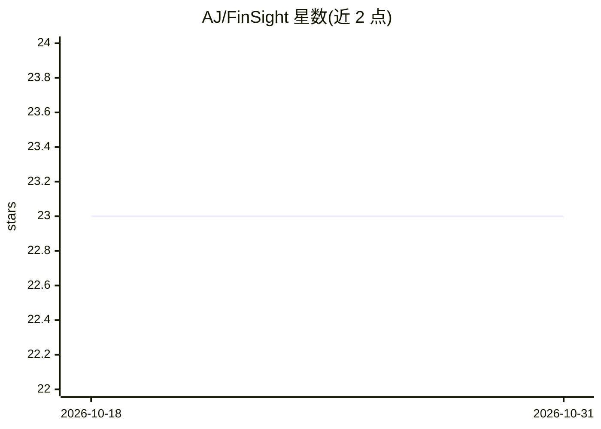

# AJ/FinSight

⭐ 23 · JavaScript · MIT · 推送 2026-09-29 · [GitHub](https://github.com/AJ/FinSight) · 个人维护

**本地 AI 分析银行/信用卡账单的个人财务可视化应用**

面向个人的财务分析工具：上传 PDF/CSV/Excel 银行或信用卡账单，由本地 LLM（Ollama 或 LM Studio 二选一，支持任意模型）提取交易、自动检测货币、智能分类并给出置信度，支持学习用户的手动修正规则、订阅与周期付款检测、预算规划，以及基于 SSE 流式的自然语言聊天问答。数据全程留在本机浏览器 localStorage（未加密），不联网、无登录。基于 Next.js 16 构建，通过 git clone 源码加 npm 运行；需先安装 Node.js 与本地 LLM 提供方，不支持 OpenAI/Anthropic 云端 API，扫描图片型 PDF 无法解析。

## 筛选速览

| 维度 | 判定 | 备注 |
|---|---|---|
| AI 角色 | `ai-native` | 本体是模型或模型工具 |
| 许可风险 | `permissive` | MIT |
| 部署形态 | `library` | 以包/库形式分发 |
| 模型依赖 | local-ok | 支持本地模型 |
| 硬件要求 | — | 无带数字的原话,不猜 |
| 安装摩擦 | `low` | 无编译、无系统依赖或容器化 |
| 成熟度 | — | 结构信号不足 |

## 能力要点

- 本地 LLM 解析账单并结构化输出交易（日期/金额/类型/货币自动检测）
- 支持 Ollama 与 LM Studio 两种本地推理后端，任意模型可用
- 周期付款/订阅检测、学习式分类规则与置信度评分
- 自然语言与账单数据对话（Server-Sent Events 流式响应），数据不离开本机

## 适用场景

- 导入银行或信用卡账单，自动分类并可视化消费趋势
- 发现遗忘的订阅与周期性扣款
- 不放心云服务时，完全离线地用自然语言询问自己的支出情况

## 场景标签

`文档解析` `数据分析` · 领域:效率与自动化

## 证据(README 行号)

> L3: **AI-powered personal finance analyzer — runs 100% locally, no cloud, no login.**
> L5: Upload a PDF / CSV / Excel bank or credit card statement → AI extracts and categorizes every transaction → interacti
> L11: |**AI Parsing**|Uses a local LLM (via Ollama or LM Studio) to extract transactions from PDFs with near-perfect accu

## 星数曲线

2026-10-18 23 → 2026-10-31 23（+0）

---
*卡片 v1 · prompt 1.4 · 生成 2026-10-27 · 置信度 high · 依据 README sha `266d22977702` · [字段定义](../../DATASET.md)*
