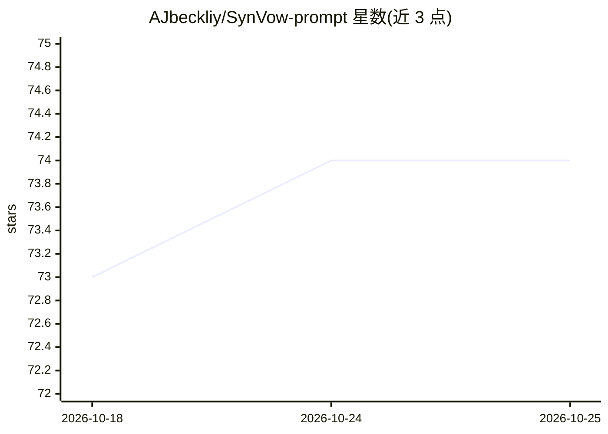

# AJbeckliy/SynVow-prompt

⭐ 74 · Python · MIT · 推送 2026-09-15 · [GitHub](https://github.com/AJbeckliy/SynVow-prompt) · 个人维护 · 中文 README

**面向 ComfyUI 的电商视觉提示词与图像工作流节点集**

ComfyUI 自定义节点集，围绕电商视觉生产提供多类节点：产品图六合一处理（精修/场景融合/高清/移除/光效/扩图）、多屏电商详情页提示词生成与长图拼接、透明素材分层提示词及 PSD 合成、文生图/图生图提示词优化、MiniMax H3 视频提示词导演。主要依赖 RunningHub 平台 API（GPT-Image-2 需企业共享 Key），也支持第三方 OpenAI-compatible LLM 备用通道。通过 git clone 安装到 custom_nodes 目录，PSD 合成需 Python 3.10+。

## 筛选速览

| 维度 | 判定 | 备注 |
|---|---|---|
| AI 角色 | `ai-ecosystem` | LLM/agent 周边工具 |
| 许可风险 | `permissive` | MIT |
| 部署形态 | `None` |  |
| 模型依赖 | — | README 未给出锁定关系 |
| 硬件要求 | — | 无带数字的原话,不猜 |
| 安装摩擦 | `low` | 无编译、无系统依赖或容器化 |
| 成熟度 | — | 结构信号不足 |

## 能力要点

- RH GPT-Image-2 产品六合一节点：精修、场景融合、高清、移除、科技光效、白边扩图
- 长卷详情页工作流：规划→页面结构→批量提示词→长图拼接
- 透明素材链路：LLM 规划 2~6 层画布坐标，输出 RGBA PNG 并合成可编辑 PSD
- H3 多参考提示词导演：生成 MiniMax H3 视频提示词，视频/音频仅传编号不传内容

## 适用场景

- 批量生成电商详情页多屏图像提示词并拼接长图
- 对产品图做精修、融入场景、移除物品等处理
- 生成可编辑分层的透明素材 PSD
- 为 MiniMax H3 视频生成准备多参考提示词

## 场景标签

`提示工程` `图像生成` · 领域:Agent 开发

## 证据(README 行号)

> L8: 🛍️ **SynVow 提示词与电商视觉工具集（v1.8）** —— 面向 ComfyUI 的 RunningHub 图像生成与提示词工作流，覆盖产品精修、功能科技特效、Mask 局部编辑、白边扩图、电商详情页、透明素材和多模态提示
> L49: 一个节点完成六类高频产品图片任务，直接输出 ComfyUI `IMAGE`、最终英文提示词和运行状态。

## 星数曲线

2026-10-18 73 → 2026-10-25 74（+1）

---
*卡片 v1 · prompt 1.4 · 生成 2026-10-24 · 置信度 high · 依据 README sha `aacf698f0f1a` · [字段定义](../../DATASET.md)*
