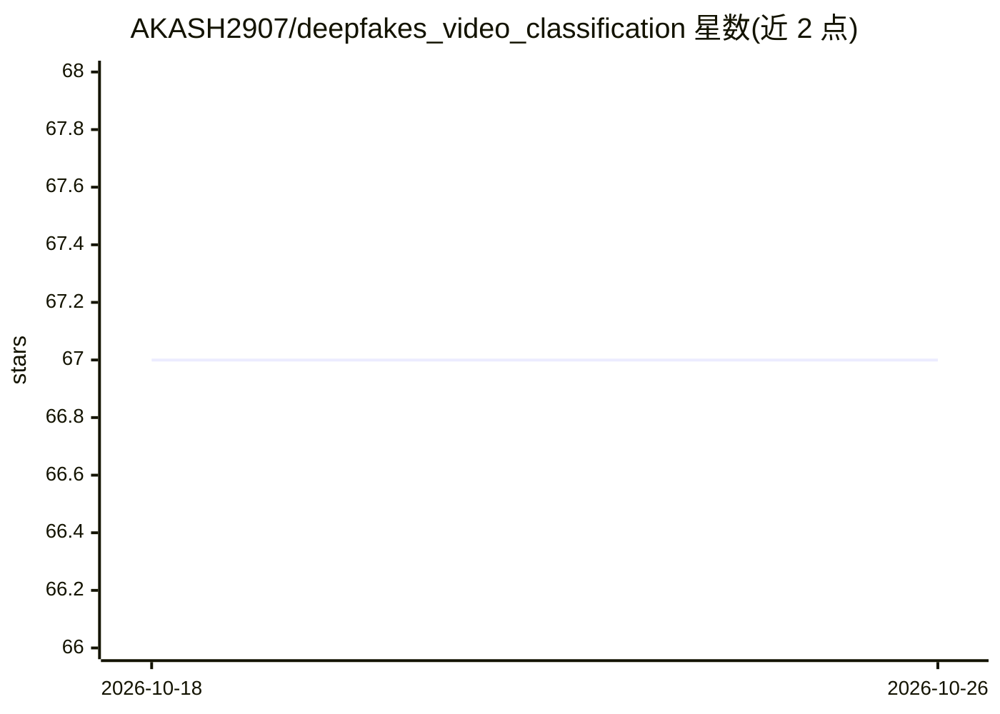

# AKASH2907/deepfakes_video_classification

⭐ 67 · Python · MIT · 推送 2026-06-10 · [GitHub](https://github.com/AKASH2907/deepfakes_video_classification) · 个人维护

**基于度量学习的深度伪造视频检测方法官方实现**

IWBF'20 论文 Deepfakes Detection with Metric Learning 的官方 Python 实现，面向深伪检测研究者。提供完整流程脚本：帧抽取、人脸抽取、训练数据准备，支持 2D CNN（XceptionNet/EfficientNet）、3D CNN（C3D）、CNN-LSTM 时序模型以及基于 facenet 嵌入与半难三元组的度量学习加传统分类器方案。在 Celeb-DF 与 FaceForensics++ 数据集上实验，报告 96%（boosting 后 98%）准确率；数据集需自行向原作者申请。依赖 Keras 2.3/TF 1.14 与 PyTorch 1.2，环境较旧。

## 筛选速览

| 维度 | 判定 | 备注 |
|---|---|---|
| AI 角色 | `ai-native` | 本体是模型或模型工具 |
| 许可风险 | `permissive` | MIT |
| 部署形态 | `library` | 以包/库形式分发 |
| 模型依赖 | — | README 未给出锁定关系 |
| 硬件要求 | — | 无带数字的原话,不猜 |
| 安装摩擦 | `low` | 无编译、无系统依赖或容器化 |
| 成熟度 | — | 结构信号不足 |

## 能力要点

- 覆盖 CNN/C3D/CNN-LSTM/三元组度量学习四类检测架构
- facenet 人脸嵌入 + 半难三元组训练 + ML 分类器方案
- Celeb-DF 上报告 96%/98%（boosting）准确率
- 提供帧抽取、人脸抽取、训练与评估的端到端脚本

## 适用场景

- 复现论文中 Celeb-DF/FaceForensics++ 深伪检测实验
- 对比不同网络架构在深伪视频分类上的表现
- 基于度量学习做伪造人脸特征分析

## 场景标签

`人脸识别` · 领域:感知与多模态

## 证据(README 行号)

> L4: This repository provides the official Python implementation of Deepfakes Detection with Metric Learning accepted at 
> L34: * train_CNN.py - Train on 2D CNN - XceptionNet model
> L101: * train_triplets_semi_hard.py - Train the triplets of face embedding vectors and then train ML classifiers such as

## 星数曲线

2026-10-18 67 → 2026-10-26 67（+0）

---
*卡片 v1 · prompt 1.4 · 生成 2026-10-24 · 置信度 mid · 依据 README sha `665f56b37d16` · [字段定义](../../DATASET.md)*
