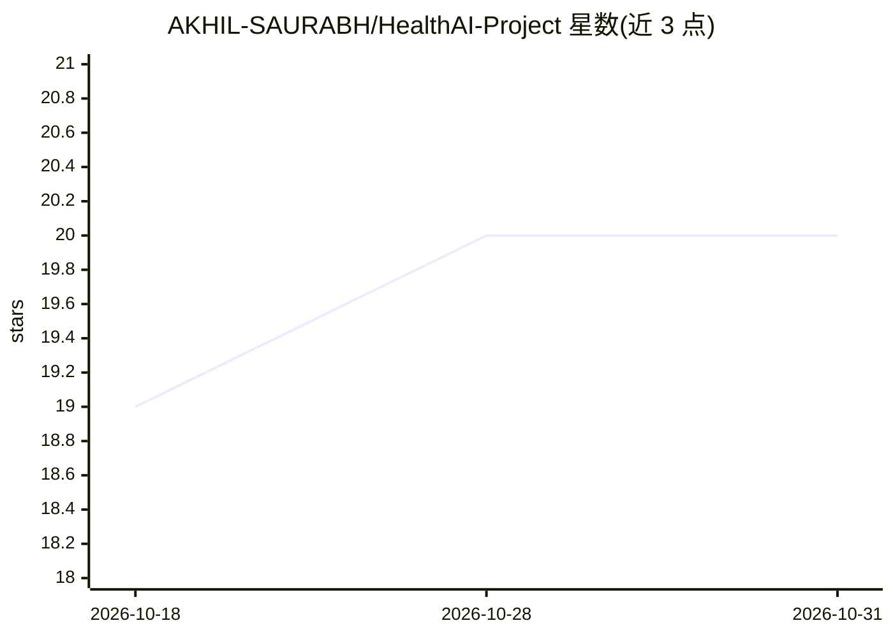

# AKHIL-SAURABH/HealthAI-Project

⭐ 20 · Jupyter Notebook · MIT · 推送 2026-06-12 · [GitHub](https://github.com/AKHIL-SAURABH/HealthAI-Project) · [官网](https://healthai-frontend-aldddrxsrswa59csqqrkij.streamlit.app/) · 个人维护

**胸部 X 光多病种检测系统：EfficientNetB0 预测 5 类疾病概率**

端到端医学影像项目：在 CheXpert 小数据集（5 种疾病）上训练 EfficientNetB0 做多标签分类，输入 224x224 胸片，输出 Atelectasis、Cardiomegaly、Consolidation、Edema、Pleural Effusion 的概率。后端为 FastAPI（POST /predict-xray、GET /health），Streamlit 仪表盘上传图片调用 API 展示结果，已部署至 Render 并提供公开访问地址。本地运行需 conda 环境、pip 安装依赖后分别启动 uvicorn 与 streamlit。作者定位为作品集项目，验证集准确率约 88%。

## 筛选速览

| 维度 | 判定 | 备注 |
|---|---|---|
| AI 角色 | `ai-native` | 本体是模型或模型工具 |
| 许可风险 | `permissive` | MIT |
| 部署形态 | `library` | 以包/库形式分发 |
| 模型依赖 | — | README 未给出锁定关系 |
| 硬件要求 | — | 无带数字的原话,不猜 |
| 安装摩擦 | `low` | 无编译、无系统依赖或容器化 |
| 成熟度 | — | 结构信号不足 |

## 能力要点

- EfficientNetB0 多标签分类，覆盖 5 类胸片疾病
- FastAPI 推理后端 + Streamlit 交互仪表盘
- 已部署 Render，提供公开 API 与在线界面
- 完整流程：数据管道→训练→评估→API→UI→部署

## 适用场景

- 上传胸片获取多病种概率预测
- 学习端到端医学影像深度学习工程流程
- 作为 ML/AI 工程岗位的作品集项目展示

## 场景标签

`目标检测` · 领域:感知与多模态

## 证据(README 行号)

> L26: **HealthAI** is an end-to-end medical imaging project that detects **multiple chest diseases** from **X-ray images*
> L31: * ⚙️ **FastAPI Backend for AI Inference**

## 星数曲线

2026-10-18 19 → 2026-10-31 20（+1）

---
*卡片 v1 · prompt 1.4 · 生成 2026-10-28 · 置信度 high · 依据 README sha `861a831072f8` · [字段定义](../../DATASET.md)*
