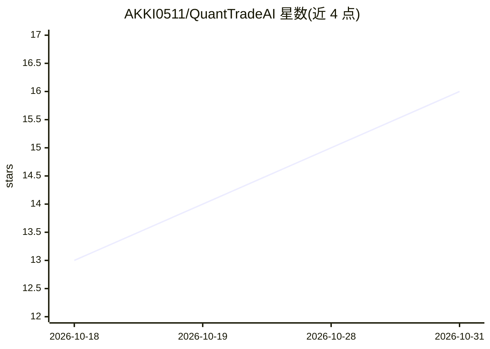

# AKKI0511/QuantTradeAI

⭐ 16 · Python · MIT · 推送 2026-07-03 · [GitHub](https://github.com/AKKI0511/QuantTradeAI) · [官网](https://akkijoshi.gitbook.io/quanttradeai) · 个人维护

**供 AI 编程 Agent 使用的量化研究 CLI 工作区**

面向 Claude Code、Codex、Cursor 等编码代理的量化研究框架：通过 `quanttradeai init` 生成含 project.yaml、AGENTS.md 与 Claude 技能包的工作区，代理用统一 CLI 执行策略实验、参数扫描、计分板比较与制品读取。内置 backtest→paper→live 晋级模型，实盘交易需人类逐步显式确认。可生成 Docker Compose 等部署包。PyPI 发布尚在稳定中，暂建议本地开发安装（poetry）。

## 筛选速览

| 维度 | 判定 | 备注 |
|---|---|---|
| AI 角色 | `ai-ecosystem` | LLM/agent 周边工具 |
| 许可风险 | `permissive` | MIT |
| 部署形态 | `self-host` | docker 或自建部署 |
| 模型依赖 | — | README 未给出锁定关系 |
| 硬件要求 | — | 无带数字的原话,不猜 |
| 安装摩擦 | `low` | 无编译、无系统依赖或容器化 |
| 成熟度 | `idea` | |

## 能力要点

- 单份 project.yaml 驱动数据、特征、研究与代理配置
- 每次运行产出结构化制品（summary/scoreboard/metrics）供代理直接读取
- backtest→paper→live 晋级制，实盘需 `--acknowledge-live` 人类确认
- 支持 rule/model/llm/hybrid 四类策略代理模板与参数扫描

## 适用场景

- 让编码代理在结构化工作区中完成策略回测与比较
- 跨多次会话积累可复现、可对比的实验制品
- 在人类逐级审批下把回测胜出策略推进到模拟/实盘

## 场景标签

`金融量化` `科研工具` · 领域:学习与行业

## 证据(README 行号)

> L15: QuantTradeAI is built for coding agents — Claude Code, Codex, Cursor, and similar tools — to research trading strat
> L17: You give the research objective. The agent uses a generated workspace, `config/project.yaml`, and the `quanttradeai

## 星数曲线

2026-10-18 13 → 2026-10-31 16（+3）

---
*卡片 v1 · prompt 1.4 · 生成 2026-10-30 · 置信度 mid · 依据 README sha `5133e0ac556b` · [字段定义](../../DATASET.md)*
