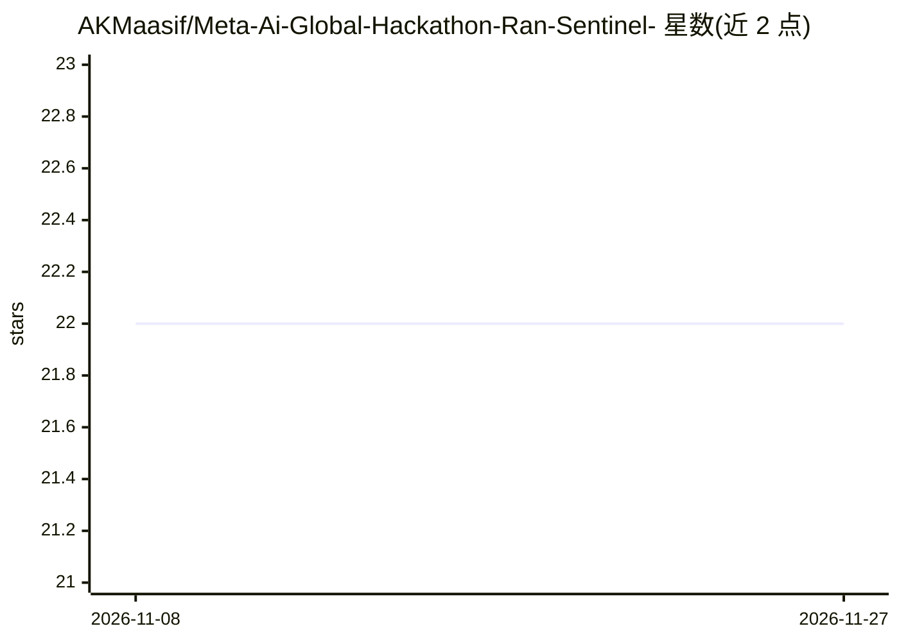

# AKMaasif/Meta-Ai-Global-Hackathon-Ran-Sentinel-

⭐ 22 · Python · MIT · 推送 2026-11-04 · [GitHub](https://github.com/AKMaasif/Meta-Ai-Global-Hackathon-Ran-Sentinel-) · [官网](https://www.youtube.com/watch?v=hcaJiB8FBA8) · 个人维护

**面向移动网络的 AI 协同工程师：监测 LTE 小区并诊断故障**

黑客松原型项目：在模拟的 LTE 网络上运行，用三种检测器发现劣化小区，Meta Muse Spark agent 以只读工具收集 KPI、告警与配置证据并提出修复方案；方案经九条固定安全规则与 Maveric 数字孪生检查、工程师批准后，以 Open M-Plane 变更包下发并支持自动回滚。包含客户侧语音助手与通俗状态更新、FCC Part 4 停机合规跟踪、206 个自动化测试。不连接真实运营商网络；Windows 本地可无 API key 运行，接入 Meta 推理需配置密钥，Docker 仅用于可选 RF 孪生。

## 筛选速览

| 维度 | 判定 | 备注 |
|---|---|---|
| AI 角色 | `ai-native` | 本体是模型或模型工具 |
| 许可风险 | `permissive` | MIT |
| 部署形态 | `desktop` | 安装包/桌面程序 |
| 模型依赖 | — | README 未给出锁定关系 |
| 硬件要求 | — | 无带数字的原话,不猜 |
| 安装摩擦 | `low` | 无编译、无系统依赖或容器化 |
| 成熟度 | `idea` | |

## 能力要点

- 三检测器（规则 + Isolation Forest + 基线）在小盆地模拟器上报告 48/48 故障检出、0 误报
- Muse Spark agent 调查 + 不可跳过的验证器 + 工程师签核流程
- 九条固定安全规则、Maveric 数字孪生 what-if、NETCONF confirmed-commit 自动回滚
- FCC Part 4 停机用户分钟数实时跟踪与合规工单

## 适用场景

- 运营商工程师自动化小区故障的证据收集与初步诊断
- 在变更下发前用安全规则与 RF 孪生核查配置方案
- 向客户推送已确认的通俗网络状态更新

## 场景标签

`语音 Agent` · 领域:对话与助手

## 证据(README 行号)

> L3: An AI co-engineer for mobile networks, built on Meta's Muse models.
> L25: RAN Sentinel watches a cluster of LTE cells in Seattle, WA (US bands B66, B2 and B71) and spots a degrading cell. M
> L34: - **Six Meta models, each with one job:** Muse Spark 1.3, 1.2 and 1.1, Muse Wonder 1.0, SAM 3.1 and Muse Voice Tran

## 星数曲线

2026-11-08 22 → 2026-11-27 22（+0）

---
*卡片 v1 · prompt 1.4 · 生成 2026-11-18 · 置信度 mid · 依据 README sha `9d80bce00a9a` · [字段定义](../../DATASET.md)*
