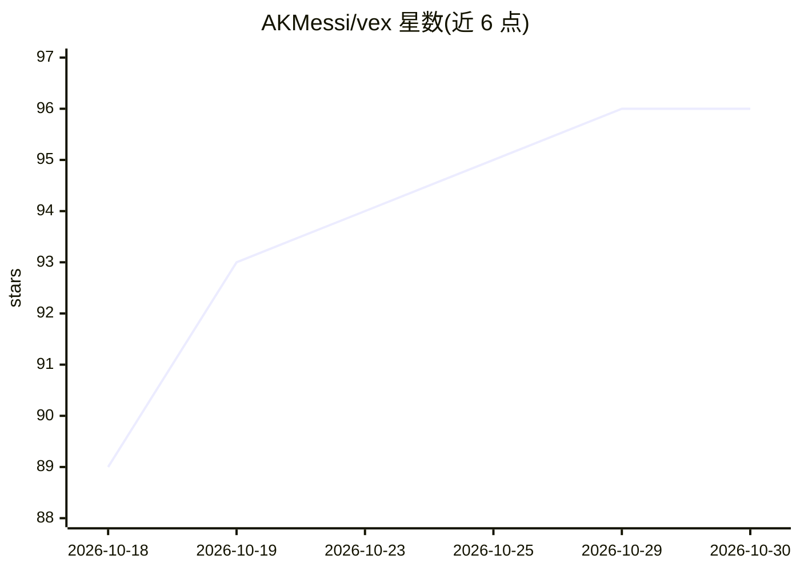

# AKMessi/vex

⭐ 96 · Python · NOASSERTION · 推送 2026-10-13 · [GitHub](https://github.com/AKMessi/vex) · 个人维护

**终端优先的 AI 视频剪辑代理：用自然语言驱动剪辑**

Vex 是源码可得、非商用的终端 AI 视频剪辑代理：用自然语言下达指令，LLM 驱动工具循环，在安全工作副本上用 FFmpeg/MoviePy 完成剪辑、调色、字幕、静音清理、短视频生成、转录与解说视觉生成（Hyperframes/Remotion/Manim/Blender 渲染栈）。原始素材不被改动，项目带时间线历史与撤销重建。多 provider 支持，Gemini 为默认，也可配置 Claude、Groq 或本地 OpenAI 兼容服务。需 Python 3.11+ 与 FFmpeg。

## 筛选速览

| 维度 | 判定 | 备注 |
|---|---|---|
| AI 角色 | `ai-native` | 本体是模型或模型工具 |
| 许可风险 | `none` | NOASSERTION |
| 部署形态 | `library` | 以包/库形式分发 |
| 模型依赖 | local-ok | 支持本地模型 |
| 硬件要求 | — | 无带数字的原话,不猜 |
| 安装摩擦 | `medium` | 含编译或系统依赖之一 |
| 成熟度 | — | 结构信号不足 |

## 能力要点

- 自然语言驱动的 FFmpeg 剪辑工具循环，编辑安全工作副本
- Whisper 本地转录、字幕感知动效与自动调色
- Shorts Director 自动生成竖屏短视频（选题、字幕、评分、清单）
- 解说视觉生成：Hyperframes/Remotion/Manim/Blender 多渲染器与验证流程

## 适用场景

- 不懂 FFmpeg 命令也能在终端完成裁剪、转码、字幕等剪辑
- 把长播客或口播视频自动切成带字幕的竖屏短视频
- 给讲解视频按转录内容自动生成并合成解说视觉动画

## 场景标签

`图像视频处理` · 领域:感知与多模态

## 证据(README 行号)

> L12: Vex is a source-available, non-commercial AI video editing agent for the terminal. Launch `vex`, talk to it in plai
> L37: - Multi-provider ready: Gemini by default, Claude, Groq Qwen native vision, or local OpenAI-compatible providers wh

## 星数曲线

2026-10-18 89 → 2026-10-30 96（+7）

---
*卡片 v1 · prompt 1.4 · 生成 2026-10-23 · 置信度 high · 依据 README sha `8f66e03166e8` · [字段定义](../../DATASET.md)*
