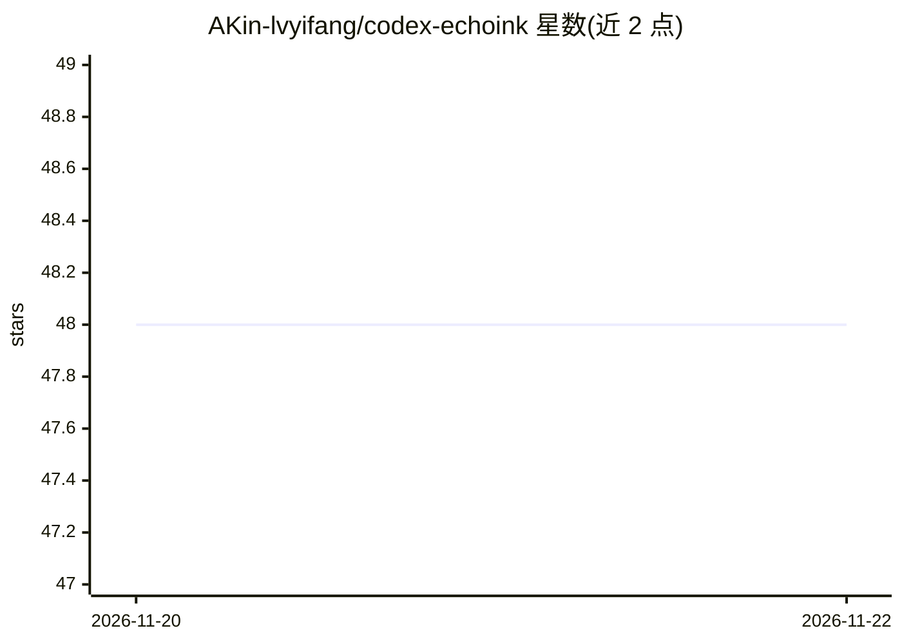

# AKin-lvyifang/codex-echoink

⭐ 48 · TypeScript · NOASSERTION · 推送 2026-11-21 · [GitHub](https://github.com/AKin-lvyifang/codex-echoink) · [官网](https://echoink.cn) · 个人维护 · 中文 README

**Obsidian 插件：与笔记对话、整理知识并维护可编辑的长期记忆**

运行在 Obsidian vault 内的 AI 助手插件：对笔记做带引用的知识问答，把新材料整理为知识库并提供体检与修复预览，维护可浏览、更正、固定或遗忘的长期记忆；日志可转为待办与记录。采用助手加角色 agent 的多智能体结构，用户在待决事项中确认决策。通过 Obsidian 社区插件市场或手动放置文件安装，需 Obsidian 1.11.4+；自带模型按 AI 点数计费，也可自备任意兼容 API key。基础插件 MIT 许可，PRO 功能另行授权。

## 筛选速览

| 维度 | 判定 | 备注 |
|---|---|---|
| AI 角色 | `ai-native` | 本体是模型或模型工具 |
| 许可风险 | `none` | NOASSERTION |
| 部署形态 | `None` |  |
| 模型依赖 | — | README 未给出锁定关系 |
| 硬件要求 | — | 无带数字的原话,不猜 |
| 安装摩擦 | `low` | 无编译、无系统依赖或容器化 |
| 成熟度 | — | 结构信号不足 |

## 能力要点

- 知识问答引用实际使用的笔记来源
- 长期记忆可浏览、更正、固定、导出或遗忘
- 本地 MCP 服务器向同机其他 agent 开放授权的知识与记忆（只读）
- 助手规划并委派任务给角色 agent 的多智能体工作流

## 适用场景

- 在 Obsidian 中直接向自己的笔记提问并获得出处引用
- 把零散资料增量整理为结构化知识库并定期体检
- 让 AI 记住个人偏好并可在本地查看和修改这些记忆
- 将 vault 内容作为上下文共享给本机其他 agent 工具

## 场景标签

`Agent 记忆` `知识库管理` `文档问答` · 领域:Agent 开发

## 证据(README 行号)

> L7:  An AI companion that lives in your Obsidian vault. It chats with your notes, keeps them organized, and remembers wh
> L26: |💬 **Chat with your notes**|Ask anything about your vault. Answers cite the notes they actually used.|
> L32: |🔌 **Your notes as context for other agents**|A local MCP server lets the agents you already use read the knowledge

## 星数曲线

2026-11-20 48 → 2026-11-22 48（+0）

---
*卡片 v1 · prompt 1.4 · 生成 2026-11-20 · 置信度 high · 依据 README sha `ed048236400e` · [字段定义](../../DATASET.md)*
