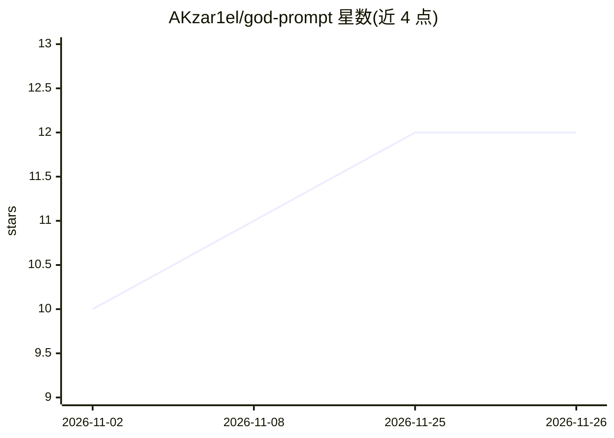

# AKzar1el/god-prompt

⭐ 12 · Python · MIT · 推送 2026-11-25 · [GitHub](https://github.com/AKzar1el/god-prompt) · [官网](https://tomiseregi.si/projects/god-prompt) · 个人维护

**给 AI 编码助手的统一工程流程提示词与 Agent Skill**

GodPrompt 是一个 1,145 行的行为工作流提示词，以 Agent Skill 和系统提示词两种形式发布，面向使用 Codex、Claude Code、ChatGPT、Cursor 等编码代理的开发者。它将任务自动分类为 BUILD/DEBUG/REFACTOR 等 9 种类型并路由到对应协议，内置 TDD、四层调试防御与完成前验证门。安装方式覆盖粘贴到 CLAUDE.md、git clone 到技能目录、ChatGPT 插件/远程 MCP、Copilot 插件市场、Skills CLI 等；另提供 49 美元的付费 Agent Harness Review 服务，MIT 部分保持免费。

## 筛选速览

| 维度 | 判定 | 备注 |
|---|---|---|
| AI 角色 | `ai-knowledge` | 知识聚合/清单类 |
| 许可风险 | `permissive` | MIT |
| 部署形态 | `library` | 以包/库形式分发 |
| 模型依赖 | — | README 未给出锁定关系 |
| 硬件要求 | — | 无带数字的原话,不猜 |
| 安装摩擦 | `low` | 无编译、无系统依赖或容器化 |
| 成熟度 | — | 结构信号不足 |

## 能力要点

- 单文件 1,145 行提示词，自称合并 30+ 技能
- 自动分类 9 种任务类型并路由到对应协议
- 渐进式披露结构：SKILL.md 入口 + 按需加载 references 文件
- 提供远程 MCP 端点，含 7 个只读工具

## 适用场景

- 给编码代理统一配置一套工程流程约束
- 在 Claude Code/ChatGPT/Codex 等多个宿主间复用同一技能
- 用验证门约束代理在声明完成前先验证代码

## 场景标签

`提示工程` · 领域:Agent 开发

## 证据(README 行号)

> L3: GodPrompt is a 1,145-line behavioral workflow prompt designed to push AI coding assistants toward a disciplined seni
> L22: A single portable Agent Skill and system-prompt workflow that replaces 30+ individual skills with one unified syste

## 星数曲线

2026-11-02 10 → 2026-11-26 12（+2）

---
*卡片 v1 · prompt 1.4 · 生成 2026-11-19 · 置信度 high · 依据 README sha `df9ded242ab6` · [字段定义](../../DATASET.md)*
